# Project ORCA — Ocean Intelligence & Tactical Marine Copilot (AMIP v6.2)

[](#-key-features--capabilities-v62)
[-1E8449)](#-testing--validation)
[](#-tactical-uiux-design-system)
[-0D2B45)](#2-global-multi-lingual-maritime-slm)
[](file:///d:/coding/Github/SIH26/docs/provenance_guidelines.md)
[](#)

**Project ORCA** (Agentic Marine Intelligence Platform — AMIP) is an evidence-first, high-density marine command center and ocean tactical copilot engineered for coastal fishers, mechanized vessel fleets, oceanographers, and maritime search-and-rescue operators worldwide.

The platform autonomously harmonizes multi-mission satellite earth observation rasters (**Sentinel-3 SLSTR/OLCI**, **MODIS Aqua**) with real-time numerical ocean forecasts (**INCOIS OSF**, **GEBCO Bathymetry**, **NOAA GFS**) to deliver real-time **Potential Fishing Zone (PFZ)** detection, Great-Circle navigational route planning, dynamic ship seaworthiness risk matrices, and multi-lingual conversational marine advisory reasoning across 50 international and domestic ports.

---

## 🏗️ System Architecture

```mermaid
flowchart TB
    subgraph Observational_Feeds ["📡 Multi-Mission Observational Feeds"]
        S3["Sentinel-3 SLSTR (SST Level 2 Thermal Gradients)"]
        MODIS["MODIS Aqua / Sentinel-3 OLCI (Chlorophyll-a Plumes)"]
        INCOIS["INCOIS OSF (Swell, Currents, Wave Height, Wind)"]
        GEBCO["GEBCO Bathymetry Grid (Depth / Reef Slopes)"]
    end

    subgraph Backend_Services ["⚙️ FastAPI Marine Microservices (Port 8000)"]
        SLM_Router["Maritime SLM Intent Classifier & Non-ASCII Router"]
        PFZ_Engine["PFZ Analytics Engine (Sobel Gradients & Multi-Zone Plumes)"]
        Chat_Engine["Marine Chat Service (Rhumb-Line Nav Solver & Risk Evaluator)"]
        Language_Engine["Regional Language Service (15+ Global Port Languages)"]
        Prov_Service["Cryptographic Provenance Engine (Zero-Hallucination Audit Trail)"]
    end

    subgraph Tactical_Frontend ["🖥️ Tactical Command Center HUD (Port 5173)"]
        Landing["Stage 1: Minimalist Search Capsule (Gemini/ChatGPT Style + Voice Mic)"]
        Workspace["Stage 2: Operational Workspace (Google Stitch Side-by-Side Layout)"]
        HUD["Tactical Top HUD & UTC Master Clock"]
        DockBar["Dock Dropdown Selector Bar (50 Global Ports)"]
        Map_Canvas["Geospatial Leaflet Canvas (ESRI Dark Marine Base)"]
        Layers["Dynamic Layers (Default: PFZ Active; SST, Chl, Depth, Wind Toggleable)"]
        Copilot["Conversational Copilot Feed (Clean Markdown-to-HTML Formatter)"]
        VesselDrawer["Ship Seaworthiness & Dynamic Risk Matrix"]
    end

    Observational_Feeds --> Backend_Services
    Backend_Services <--> Tactical_Frontend
```



---

## 🌟 Key Features & Capabilities (v6.2 - Finalized)

### 1. Progressive Two-Stage Interface (Google Stitch Inspired)
- **Stage 1: Minimalist Landing Screen**: A distraction-free, centered prompt capsule with speech recognition mic input and quick-launch directive chips (*Bangda in Mumbai*, *Bay of Bengal Status*, *Kochi Harbor Safety*, *Daryavar Jaycha Ka*, *Inniku Kadal Epdi*).
- **Stage 2: Operational Workspace**: Fluid animated transition from the landing screen to a high-density, split-screen command layout:
  - **Left Side**: Conversational Marine Intelligence Copilot with formatted HTML responses, evidence badges, and interactive action chips.
  - **Right Side**: Full-viewport Leaflet geospatial canvas with coordinate tracking, 10 nm safety perimeter, live oceanographic layers, and draggable waypoints.
  - **Bottom Dock Bar**: Pinned harbor drop-down bar allowing 1-click spatial teleportation across 50 international and domestic ports.

### 2. Global Multi-Lingual Maritime SLM
- **Native Script & Language Support**: Direct processing and native response generation for:
  - **East Asian**: Japanese (`ja` - Hiragana, Katakana, Kanji), Chinese (`zh` - Simplified & Traditional Hanzi), Korean (`ko` - Hangul).
  - **European**: Spanish (`es`), French (`fr`), Portuguese (`pt`), Dutch (`nl`), German (`de`), Norwegian (`no`).
  - **Middle Eastern & SE Asian**: Arabic (`ar`), Indonesian (`id`).
  - **Indic Coastal**: Hindi (`hi`), Marathi (`mr`), Tamil (`ta`), Malayalam (`ml`), Telugu (`te`), Bengali (`bn`), Gujarati (`gu`), Kannada (`kn`).
- **Dynamic Language Session Switching**: Current input language immediately overrides previous session states, eliminating cross-lingual fallback bugs.
- **Vernacular Fish Directory**: Over 40 species mapped across scientific binomials and local coastal nomenclature (e.g. *Lateolabrax japonicus* -> Japanese Sea Bass / Suzuki [スズキ / 鱸], *Trachurus japonicus* -> Aji [アジ / 鰺], *Rastrelliger kanagurta* -> Indian Mackerel / Bangda [बांगडा]).

### 3. Dynamic Oceanographic Layers & Dual Layer Control
- **Default Startup State**: In accordance with maritime operational protocols, **only the Potential Fishing Zone (PFZ) layer is active by default**, ensuring a clean, uncluttered tactical canvas.
- **5 Dynamic Oceanographic Overlays**:
  1. **PFZ Front Plumes (Multi-zone)**: Alpha (Thermal Front), Bravo (Upwelling Gyre), and Charlie (Shelf Break) dynamic polygons derived from satellite gradients.
  2. **SST Isotherm Contours**: 5 smooth, curved physical isotherms ($27.5^\circ\text{C}$ to $29.5^\circ\text{C}$) contoured along continental shelf bathymetry.
  3. **Chlorophyll Bloom Plumes**: Multi-intensity chlorophyll-a front polygons ($0.40$ to $2.20\text{ mg/m}^3$).
  4. **Bathymetric Depth Grid**: Isobath contours (-10m, -25m, -50m, -100m) with reef and shallow-water alerts.
  5. **GPU-Accelerated Thermal Wind Streamlines**: High-performance HTML5 Canvas particle engine rendering real-time wind velocity and direction.
- **Dual Layer Control**:
  - **Manual Control**: Toggle layers on/off at any time using the Tactical Controls drawer.
  - **Conversational Chat Control**: Toggle layers directly via natural language (e.g., *"show SST"*, *"turn on chlorophyll"*, *"hide depth"*, *"only PFZ"*, *"show all layers"*, *"SSTを表示"*, *"显示水温"*).

### 4. Strict Seaward Water Clamping (Zero Land Overlap)
- **Anti-Terrestrial Ray-Casting**: Real-time Point-in-Polygon (PIP) engine rejecting accidental land clicks and preventing pins from being placed on continental terrain.
- **Dedicated Seaward Bounding Clamps**: Island and estuarine ports have dedicated directional vectors and hard geographic bounding clamps guaranteeing all oceanographic features remain strictly in open marine water:
  - **Port of Singapore**: Clamped strictly South into the Singapore Strait marine fairway ($1.215^\circ\text{N}$, $103.65^\circ-104.10^\circ\text{E}$).
  - **Port of Shanghai / Yangtze Estuary**: Clamped strictly East into the East China Sea ($\ge 121.92^\circ\text{E}$, $30.60^\circ-31.60^\circ\text{N}$).
  - **Port of New York & New Jersey**: Clamped strictly South into the New York Bight / Atlantic waters ($\le 40.46^\circ\text{N}$, $-74.15^\circ \text{ to } -73.30^\circ\text{W}$).
  - **Tokyo Bay**: Clamped strictly South into central Tokyo Bay / Uraga Suido ($\le 35.53^\circ\text{N}$, $139.68^\circ-140.05^\circ\text{E}$).
  - **San Francisco**: Clamped strictly West into open Pacific waters ($\le -122.52^\circ\text{W}$, $37.60^\circ-37.95^\circ\text{N}$).
  - **Port of Rotterdam**: Clamped strictly West into the open North Sea ($\le 4.06^\circ\text{E}$, $51.85^\circ-52.20^\circ\text{N}$).

### 5. Ship Seaworthiness & Dynamic Risk Matrix
- **Customizable Vessel Profiles**: Motorized Skiff (OBM), Mechanized Trawler, Artisanal Catamaran, Deep Sea Longliner.
- **Dynamic Threshold Sliders**: Live adjustment of maximum allowable wave height ($0.5\text{m}-4.0\text{m}$) and wind speed ($10-60\text{ km/h}$).
- **Instant Risk Evaluation**: Automatic classification into `[CLEAR] SAFE TO SAIL`, `[CAUTION] MARGINAL OPERATING ENVELOPE`, or `[PROHIBITED] DANGER (EXCEEDS LIMITS)`.

### 6. Strict Provenance & Mission Dossier PDF Export
- Every recommendation is cryptographically bound to raw datasets (`dataset:sentinel3_sst`, `dataset:modis_chl`, `dataset:incois_osf`, `dataset:gebco_bathymetry`) with unique Task IDs and Trace IDs.
- **1-Click Mission Dossier Export**: Generates a standardized A4 tactical departure manifest with GPS waypoints, ocean state observations, safety directives, emergency distress frequencies (VHF Ch 16, DSC Ch 70, MRCC toll-free 1554), and SHA-256 digital signature.

---

## 🎨 Tactical UI/UX Design System (Palette A)

Project ORCA strictly enforces **Palette A** (*Salt and deep water*) across the entire user interface:

| Role | Color Name | Hex Code | Purpose in UI |
|---|---|---|---|
| **Base Surface** | Ink Sea | `#102A31` | Deep command canvas, header, panel backgrounds |
| **Primary Accent** | Deep Current | `#0F6382` | Action buttons, active navigation states, primary borders |
| **Secondary Accent** | Neel Indigo | `#2F4B9B` | Intermediate contour bands, deep-water indicators |
| **Active Highlight** | Tide | `#A9D1CB` | PFZ default plumes, GPS coordinates, live badges |
| **Muted Fill** | Sea Glass | `#E1EEEA` | Secondary overlays, light contrast chips |
| **Grid Lines & Borders** | Driftwood | `#D9CDB8` | Hairline dividers, subtle framing borders |
| **Subtle Foreground** | Wet Sand | `#5F5747` | Muted labels, secondary telemetry units |
| **Light Canvas Card** | Sand Paper | `#F5F0E6` | High-contrast printable areas, daylight mode surface |
| **Panel Surface** | Shell | `#FCFAF5` | Crisp modal wells, entry backgrounds |
| **High-Contrast Dark** | Charcoal | `#17262B` | Core typography on light backgrounds |
| **Text Primary** | Crisp White | `#FFFFFF` | Maximum legibility typography on dark backgrounds |
| **Safety: Clear** | Emerald Green | `#1E8449` / `#4CC38A` | Clear to sail status badges |
| **Safety: Caution** | Marine Amber | `#FFD52E` / `#E9761A` | Marginal operational envelope warnings |
| **Safety: Danger** | Crimson Alert | `#A61B1B` / `#F0625E` | Exceeds vessel tolerance limits / departure prohibited |

> **Design Constraints**:
> - **Zero Gradients**: Solid fills and calibrated opacity only.
> - **Zero Emojis**: Clean SVG icons and military-style bracketed badges (`[CLEAR]`, `[CAUTION]`, `[PROHIBITED]`).
> - **Border Radius**: Strictly capped at a maximum of `8px`.

---

## 📁 Repository Structure

```text
SIH26/
├── backend/                        # FastAPI Microservices Backend
│   ├── api/
│   │   └── openapi.yml             # OpenAPI 3.0 specification for all endpoints
│   ├── scripts/
│   │   └── start-local.sh          # Local backend bootstrap script
│   ├── src/
│   │   ├── main.py                 # FastAPI Application Entrypoint & CORS Middleware
│   │   ├── config.py               # Pydantic Settings & Environment Configurations
│   │   ├── api/routes/             # API Endpoints (/health, /v1/chat, /v1/analytics/pfz)
│   │   ├── data/                   # Marine species taxonomy & vernacular directories
│   │   ├── models/                 # Provenance, Chat, PFZ, and Vessel Profile Pydantic schemas
│   │   ├── services/               # PFZ Engine, Marine Chat AI, Regional Language Service, RAG Engine
│   │   ├── db/schema.sql           # PostGIS Spatial & Timescale telemetry schemas
│   │   └── pipeline/               # Satellite & Ocean numerical raster ingest pipelines
│   └── tests/                      # 51-suite Pytest unit & integration test coverage
├── frontend/                       # Tactical Command Center Dashboard
│   ├── index.html                  # Stage 1 Landing + Stage 2 Workspace HTML5 structure
│   ├── src/
│   │   ├── app.js                  # Map engine, layer toggles, chat router, water clamping
│   │   └── wind-engine.js          # GPU-accelerated HTML5 Canvas particle wind streamlines
│   ├── styles/
│   │   ├── variables.css           # Palette A CSS custom properties
│   │   └── main.css                # Progressive layout styling & tactical components
│   └── scripts/
│       └── verify-palette.js       # Automated UI design system compliance linter
├── docs/                           # Authoritative Documentation & Specifications
│   ├── workout_plans/              # Archived progressive engineering workout plans (v3.0 - v6.0)
│   │   ├── README.md               # Workout plans index & evolution timeline
│   │   ├── orca_v3_workout_plan.md # Minimalist Landing Screen & Progressive UI plan
│   │   ├── orca_v3_2_workout_plan.md# Voice input, 50 harbors & dock selector plan
│   │   ├── orca_v4_workout_plan.md # 8 core marine questions & 5 dynamic layers plan
│   │   └── orca_v6_workout_plan.md # Multi-lingual SLM, water clamping & dual layer control
│   ├── agents.md                   # Agent behavioral constraints & dev loop rules
│   ├── datasets_catalog.md         # Canonical satellite & oceanographic dataset directory
│   ├── provenance_guidelines.md    # Cryptographic provenance schemas
│   └── ui/manifest.json            # Stitch MCP sync records
├── ops/                            # SRE & Operations
│   ├── cycle-monitor/              # Developer-manager dev loop monitoring daemon
│   └── runbook.md                  # SRE incident & rollback procedures
├── infra/                          # Cloud Infrastructure (K8s, Terraform, Helm)
├── package.json                    # Workspace metadata (v6.0.0)
├── pyproject.toml                  # Python package configuration
└── server.js                       # Local dev proxy & asset server
```

---

## 🚀 Quickstart & Local Execution

### Prerequisites
- **Python 3.11+** (executable as `py` or `python`)
- **Node.js 18+** (for frontend static server & palette linter)
- Modern web browser (Chrome, Edge, Firefox, Safari)

### 1. Launch the Backend API Server
```bash
py -m uvicorn backend.src.main:app --host 127.0.0.1 --port 8000
```
- **API Status**: [http://127.0.0.1:8000/health](http://127.0.0.1:8000/health)
- **Interactive Swagger Docs**: [http://127.0.0.1:8000/docs](http://127.0.0.1:8000/docs)

### 2. Launch the Tactical Frontend Dashboard
```bash
node server.js
# OR: py -m http.server 5173 --directory frontend
```
- **Tactical Command Center**: [http://127.0.0.1:5173](http://127.0.0.1:5173)

---

## 🧪 Testing & Validation

### 1. Run the Backend Automated Test Suite
```bash
py -m pytest backend/tests -v
```
All **51 test suites** pass with 100% green coverage:
- Japanese & Chinese multi-lingual parsing & non-stale language switching
- Global port seaward water clamping (Singapore, Shanghai, New York, Tokyo Bay, Rotterdam, San Francisco)
- 8 Core Marine Question answers & PFZ polygon topology closure
- Satellite raster ingest pipelines & cryptographic provenance verification

### 2. Run the Design System & Palette Compliance Validator
```bash
node frontend/scripts/verify-palette.js
```
```text
Palette & Design System validation passed: 100% compliant with Palette A.
```

---

## 📡 API Reference Summary

### `POST /v1/chat`
Process multi-lingual conversational marine queries with dynamic SLM routing and vessel safety evaluations.

**Sample Request (Multi-Lingual / Japanese):**
```json
{
  "user_id": "operator_ja",
  "message": "東京湾の魚",
  "coordinates": [35.65, 139.84],
  "vessel_profile": {
    "type": "motorized_skiff",
    "max_safe_wind_kmh": 25.0,
    "max_safe_wave_m": 1.5
  }
}
```

**Sample Response:**
```json
{
  "reply": "**海洋気象および漁業安全情報 (Tokyo Bay / 東京湾 (Japan)):**\n\n- **有義波高 (Significant Wave Height):** **0.9 m**\n- **表面風速 (Wind Speed):** **18.1 km/h**\n- **海面水温 (SST):** **17.7 °C**\n- **有望漁場・対象魚種 (Target Pelagic Species / PFZ):** Japanese Sea Bass / Suzuki (*Lateolabrax japonicus*) — Suzuki (スズキ / 鱸), Atlantic / Pacific Cod (*Gadus morhua*) — Tara / Ma-dara (タラ / 真鱈)\n- **航行針路と距離 (Nav Bearing):** 42.4° NE, ~13.0 nm",
  "safety_status": "safe",
  "confidence": 0.92,
  "suggested_actions": ["東京湾マップを表示 (View Map)", "波浪・風速予報 (Weather)", "船舶安全基準 (Vessel)"],
  "spatial_target": {
    "lat": 35.53,
    "lon": 139.80,
    "label": "Tokyo Bay / 東京湾 (Japan)",
    "zoom": 11
  }
}
```

---

### `POST /v1/analytics/pfz`
Calculate dynamic multi-zone Potential Fishing Zones with strict seaward water boundaries.

**Sample Request:**
```json
{
  "bbox": [103.65, 1.10, 104.10, 1.25],
  "min_chlorophyll_threshold": 0.3,
  "sst_gradient_threshold": 0.8
}
```

**Sample Response:** Returns a GeoJSON `FeatureCollection` containing closed polygon geometries, thermal gradient scalars, chlorophyll-a concentrations, localized target species, and cryptographic provenance evidence.

---

## 📚 Workout Plans Archive
For a deep dive into the engineering history, architectural decisions, and progressive milestones of Project ORCA, consult the [**Workout Plans Archive**](./docs/workout_plans/README.md).