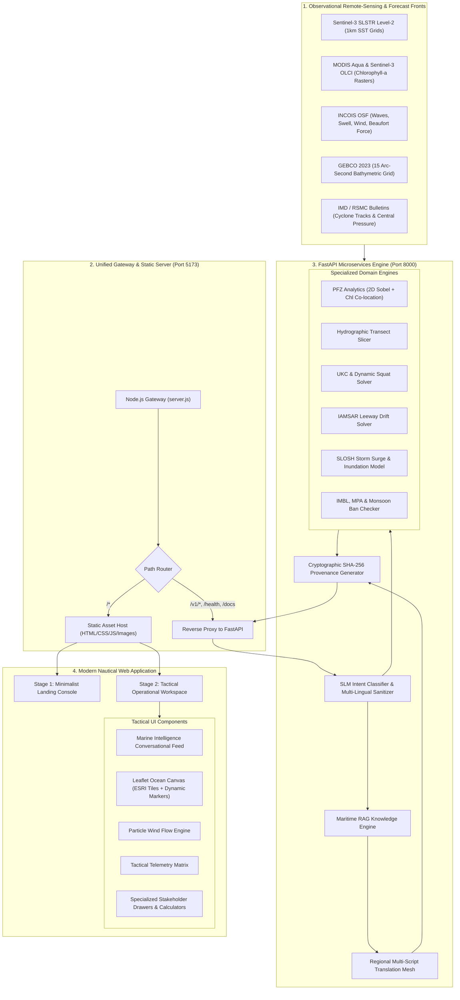
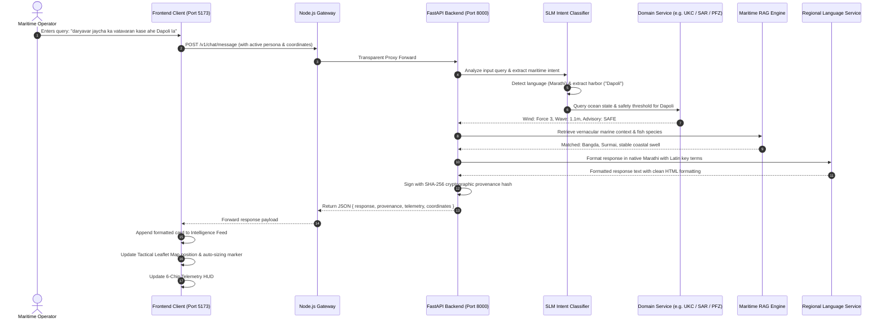
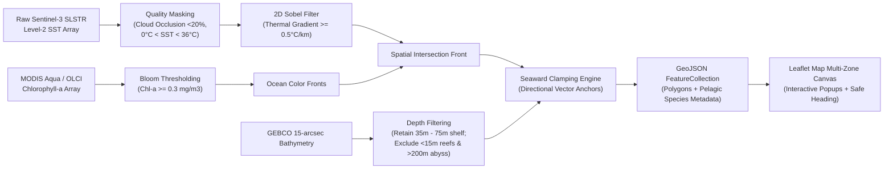

# Project ORCA — Comprehensive Project Gist & Architecture Guide

**Version**: 7.0.0 (AMIP v7.0 — *Tethys Sentinel*)  
**System**: Agentic Marine Intelligence Platform & Multi-Stakeholder Ocean Tactical Command Copilot  
**Authoritative Documentation**: [`docs/project_gist.md`](file:///d:/coding/Github/SIH26/docs/project_gist.md)  
**Last Updated**: September 2026

---

## 1. Executive Summary & Project Gist

### 1.1 What is Project ORCA?
**Project ORCA** (Agentic Marine Intelligence Platform — AMIP) is an evidence-first, high-density marine command center and conversational AI copilot. It is engineered to solve critical maritime challenges for coastal fishers, research oceanographers, maritime law enforcement, disaster response agencies, and commercial vessel operators across **50+ worldwide ports and coastal sectors**.

At its core, Project ORCA harmonizes **multi-mission satellite Earth observation rasters** (Sentinel-3 SLSTR, MODIS Aqua, Sentinel-3 OLCI) with **real-time numerical ocean forecasts** (INCOIS Ocean State Forecasts, GEBCO 2023 Bathymetry, NOAA GFS, IMD Cyclone Bulletins). It translates complex raw oceanographic measurements into actionable, high-conviction tactical advisories:
- Real-time **Potential Fishing Zones (PFZ)** co-locating thermal fronts and phytoplankton blooms.
- Multi-parameter **Hydrographic Transect Slicing** (SST, Chlorophyll-a, Bathymetry profiles).
- Dynamic **Under-Keel Clearance (UKC)** and vessel squat solving for safe harbor transit.
- **IAMSAR Leeway Drift Datum** computation and expanding square search patterns for Search & Rescue (SAR).
- **Cyclonic Storm Surge & Coastal Inundation Modeling** with official port danger signals (1–11) and Common Alerting Protocol (CAP) XML dispatch.
- **Geofence Enforcement** for sovereign International Maritime Boundary Lines (IMBL), Marine Protected Areas (MPA), and the uniform 61-day monsoon fishing ban.
- Multi-lingual conversational advisory supporting **English and 8+ Indic & global coastal languages** with zero hallucination.

### 1.2 Core Architectural Philosophy
1. **Evidence-First & Zero Hallucination**: No AI response is emitted without an underlying cryptographic provenance record containing raw sensor timestamps, geographic coordinates, bounding boxes, and source algorithm signatures.
2. **Multi-Stakeholder Operational Sovereignty**: Reconfigures the user interface, active geospatial layers, analytical tools, telemetry density, and conversational reasoning depending on the active stakeholder persona.
3. **Strict Nautical Design Language (Palette A)**: Built to military/nautical instrument standards. 100% compliant with Palette A (*Salt and Deep Water*), strictly zero generic gradients, max 8px border-radius, zero emojis, and dual tactical themes (*Chart Paper* for day navigation and *Night Bridge* for night operations).
4. **Resilient Local Gateway**: Fully deployable on standard hardware via a unified dual-server architecture: FastAPI backend on port 8000 and Node.js gateway on port 5173.

---

## 2. Complete Technology Stack

| Layer | Component | Version / Spec | Role & Functionality |
|:---|:---|:---|:---|
| **Backend Framework** | **FastAPI** | `0.115+` / `0.141+` | Asynchronous REST API routing, Pydantic request/response serialization, OpenAPI documentation |
| **Runtime Language** | **Python** | `3.11+` (3.14 verified) | High-performance backend analytics, mathematical modeling, and AI orchestration |
| **Data Validation** | **Pydantic V2** | `2.10+` / `2.13+` | Strict schema validation, typed models for all 5 stakeholder personas, immutable configuration |
| **ASGI Server** | **Uvicorn** | `0.34+` / `0.52+` | Production asynchronous ASGI server running microservices on `127.0.0.1:8000` |
| **Scientific Computing** | **NumPy & SciPy** | `2.2+` / `1.17+` | 2D matrix convolution (Sobel operators for SST gradients), numerical interpolation, trigonometric solvers |
| **Geospatial Math** | **Shapely & PyProj** | `2.1+` | Geodesic great-circle & Rhumb-line navigation, polygon intersection, IMBL distance buffers |
| **AI / NLP Intelligence** | **Maritime SLM Classifier** | Custom Heuristic SLM | Intent extraction, non-ASCII multi-lingual tokenizer, zero-hallucination domain firewall |
| **RAG Knowledge Engine** | **Maritime RAG Engine** | BM25 / Vector hybrid | Specialized knowledge retrieval for CMFRI prices, IAMSAR manuals, DG Shipping circulars, IMD scales |
| **Vernacular Translation** | **Regional Language Service** | Rule & Phonetic Mesh | Native multi-script translation (Hindi, Bengali, Tamil, Telugu, Malayalam, Marathi, Gujarati) |
| **Frontend Core** | **Vanilla HTML5 & ES6+ JS** | ECMAScript 2023 | Lightweight, zero-framework, dependency-free frontend ensuring instant load times (<150ms) |
| **Styling & Design** | **Vanilla CSS3 (Design Tokens)** | Custom CSS Variables | Strict Palette A tokens, CSS grid/flexbox, dual theme system (`data-theme="light"` and `"dark"`) |
| **Geospatial Mapping** | **Leaflet.js** | `1.9.4` | Interactive tile rendering, custom auto-sizing waypoint markers, geofence polygons, and range circles |
| **Basemap Tiles** | **ESRI World Dark & Light Canvas** | REST MapServer | Crisp, watermark-free nautical basemaps matching Chart Paper and Night Bridge themes |
| **Particle Simulation** | **HTML5 2D Canvas Engine** | Custom (`wind-engine.js`) | Real-time particle streamlines simulating thermal wind velocity and direction across ocean sectors |
| **Background Contours** | **Bathymetric Canvas Engine** | Procedural Canvas | Dynamic concentric depth rings pulsing on the landing console |
| **Gateway & Static Host** | **Node.js Gateway Server** | Node.js `22.20+` | Built-in HTTP static asset server + transparent reverse proxy forwarding `/v1/*` to FastAPI |
| **Testing Framework** | **Pytest & Pytest-Cov** | `9.1+` / `7.1+` | Automated testing suite with 58/58 passing unit and integration tests |
| **Palette Validator** | **Custom Design Checker** | Node.js script | Strict regex scanner enforcing Palette A colors, max 8px radii, and zero gradient/emoji rules |
| **Video Production Engine** | **`brag` / `brag-slim`** | Hyperframes & FFmpeg 7.1 | Automated 20s 1080p 30fps launch video generator with synthesized audio and bundled SFX |

---

## 3. End-to-End System Workflows

### 3.1 Global System Architecture Diagram



---

### 3.2 Workflow 1: Conversational AI Copilot Lifecycle



---

### 3.3 Workflow 2: Potential Fishing Zone (PFZ) Detection Pipeline



---

## 4. Comprehensive Feature Catalog

### 4.1 Fisher Persona (`fisher`)
*Target Audience: Artisanal motorized skiff operators, mechanized purse-seine & gillnet trawler crews.*

1. **Potential Fishing Zone (PFZ) Detection**:
   - Multi-zone vector polygons identifying oceanographic upwelling zones where thermal breaks intersect chlorophyll bloom edges.
   - Species forecasts: Indian Oil Sardine (*Sardinella longiceps*), Indian Mackerel (*Rastrelliger kanagurta*), Yellowfin Tuna, and Kingfish.
2. **Catch ROI & Fuel Payback Calculator**:
   - Computes vessel horsepower (HP), specific fuel consumption (SFC), transit distance (km/nm), and net diesel cost.
   - Compares total trip expenditure against expected pelagic catch value based on live CMFRI landing price averages.
3. **Harbor Bar-Crossing Tidal Window**:
   - Astronomical tidal calculation warning fishers when river mouth / harbor sandbars have insufficient water depth for departure.
4. **IMBL Sovereign Border Proximity Geofencing**:
   - Real-time geodesic monitoring against International Maritime Boundary Lines (e.g. India-Sri Lanka Palk Strait, India-Pakistan Sir Creek).
   - Generates multi-stage alerts: **Advisory** at 3.0 nm, **Hazard Alarm** at 1.0 nm.
5. **Vernacular Voice & Script Input**:
   - Supports natural coastal queries in Marathi (*"daryavar jaycha ka"*), Tamil (*"inniku kadal epdi"*), Hindi, Bengali, Telugu, and Gujarati.

---

### 4.2 Oceanographic Researcher Persona (`researcher`)
*Target Audience: Marine biologists, physical oceanographers, and research vessel scientists.*

1. **Hydrographic Transect Slicer (`POST /v1/stakeholders/hydrography/transect`)**:
   - Slices vertical profiles across user-drawn offshore transects with up to 100 equidistant sample stations.
   - Extracts simultaneous depth ($m$), SST ($^\circ\text{C}$), and Chlorophyll-a ($\text{mg/m}^3$).
   - Automatically computes thermocline slope ($^\circ\text{C/km}$) and flags Ekman upwelling signatures.
2. **SLSTR Thermal Front Gradient Analysis**:
   - 2D Sobel gradient operator visualizing high-resolution ocean temperature boundaries and eddy formations.
3. **Marine Heatwave (MHW) & Coral Bleaching Alert**:
   - Calculates Degree Heating Weeks (DHW) above maximum monthly mean (MMM) baselines for delicate coral reefs (Gulf of Mannar, Lakshadweep, Andaman & Nicobar).
4. **Phytoplankton & Chlorophyll Bloom Tracking**:
   - OLCI / MODIS Aqua spectral analysis highlighting eutrophic plumes and harmful algal bloom (HAB) candidates ($>1.5\text{ mg/m}^3$).
5. **Scientific Data Package Export**:
   - Exports CF-1.8 compliant NetCDF-4 metadata packages and tabular CSV hydrographic station logs.

---

### 4.3 Coastal Enforcement & SAR Authority Persona (`authority`)
*Target Audience: Indian Coast Guard, Marine Police, Fisheries Enforcement, and MRCC coordination centers.*

1. **IAMSAR Leeway Drift Solver (`POST /v1/stakeholders/search-rescue/datum`)**:
   - Implements International Aeronautical and Maritime Search and Rescue (IAMSAR) manual drift vector equations.
   - Integrates Total Water Current (TWC) with 10-meter surface wind leeway coefficients across 14 craft categories (*unanchored skiffs, life rafts, person-in-water*).
   - Calculates search datum coordinates, probable drift ellipse ($\text{nm}^2$), and creates an **Expanding Square Search Pattern** with GPS waypoints.
2. **Marine Protected Area (MPA) Sanctuary Geofence**:
   - Enforces strict no-trawling boundaries around Olive Ridley turtle breeding grounds (Gahirmatha Marine Sanctuary, Rushikulya rookery, Bhitarkanika).
3. **Uniform 61-Day Monsoon Ban Monitor**:
   - Enforces regional fisheries conservation bans (East Coast: April 15 – June 14; West Coast: June 1 – July 31) with fine schedules under the Marine Fishing Regulation Act (MFRA).
4. **Vessel Manifest & Biometric Licensing Registry**:
   - Digital inspection checklists verifying boat biometric ID cards, distress alert transmitters (DAT), lifejackets, and AIS-B transponders.

---

### 4.4 Disaster Management Agency Persona (`disaster`)
*Target Audience: State Disaster Management Authorities (SDMA), NDMA, NDRF, and Port Emergency Officers.*

1. **Cyclonic Storm Surge & Coastal Inundation Model (`POST /v1/stakeholders/disaster/surge-inundation`)**:
   - Modified SLOSH numerical approximation combining central atmospheric pressure deficit (inverted barometer effect) with shallow-water wind stress setup.
   - Calculates peak surge height ($m$) and estimates inland seawater penetration distance ($km$).
2. **WMO / IMD Port Warning Signals 1–11**:
   - Evaluates system proximity and automatically declares official port cautionary flags:
     - Signal 1–2: Cautionary / Warning (Distant system)
     - Signal 3–4: Danger (Port threatened)
     - Signal 5–7: Severe Danger (Port experiencing squall / left or right of landfall)
     - Signal 8–10: Great Danger (Core cyclone crossing port)
     - Signal 11: Total Communication Breakdown
3. **Common Alerting Protocol (CAP v1.2) XML Dispatch**:
   - Emits OASIS-compliant CAP XML alert payloads formatted for immediate ingestion by national disaster messaging gateways.
4. **Storm Surge & Evacuation Buffer Zones**:
   - Dynamic map overlays highlighting vulnerable coastal blocks, fishing villages, and estuary embankments within the projected flood radius.

---

### 4.5 Commercial Maritime & Port Operator Persona (`maritime`)
*Target Audience: Cargo vessel masters, offshore supply vessel (OSV) captains, harbor pilots, and port trusts.*

1. **Dynamic Under-Keel Clearance (UKC) Solver (`POST /v1/stakeholders/navigation/ukc`)**:
   - Computes dynamic vessel squat using the standard Dr. C.B. Barrass formula:
     $$\text{Squat} = \frac{C_b \cdot V^{2.08}}{30} \quad (\text{confined channel}) \quad \text{or} \quad \frac{C_b \cdot V^{2.08}}{60} \quad (\text{open water})$$
     *(where $C_b$ is the block coefficient and $V$ is speed in knots).*
   - Factors charted channel depth, astronomical tide, wave motion allowances, and gross vessel draft to calculate net UKC.
2. **Tidal Window Passage Planner**:
   - Identifies high-water tidal crest windows granting safe passage for deep-draft container ships and bulk carriers.
3. **Navigational Fairways & Restricted Anchorage**:
   - Dedicated chart lines designating deep-water traffic separation schemes (TSS), pilot boarding stations, and turning basins.
4. **Offshore Energy Platform 500m Safety Rings**:
   - Enforces UNCLOS Article 60 500-meter safety exclusion perimeters around offshore oil platforms (e.g. Mumbai High, Krishna Godavari basin).

---

### 4.6 Universal Platform Capabilities (All Personas)
1. **Interactive Leaflet Ocean Canvas**:
   - Smooth pan/zoom, interactive waypoint dropping, draggable harbor markers, dynamic circle overlays, and instant coordinate lookup.
2. **Auto-Sizing Tactical Harbor Marker**:
   - Dynamic waypoint pills (`.tactical-harbor-pill`) that automatically expand to fit long location labels (e.g. `ARABIAN SEA (WEST COAST & OFFSHORE BASIN)`) with zero text overflow.
3. **Real-Time Thermal Wind Particle Engine (`wind-engine.js`)**:
   - High-performance HTML5 2D Canvas particle simulation animating wind streamlines with speed-dependent particle densities and directional flow vectors.
4. **Dual Tactical Nautical Themes**:
   - **Chart Paper** (`[data-theme="light"]`): Warm sunlight-readable cream parchment (`#EDE7D8`), deep teal instruments (`#2B6F7A`), and crisp dark typography (`#1D2B26`).
   - **Night Bridge** (`[data-theme="dark"]`): Deep ocean nocturnal bridge (`#0A1520`), dark panels (`#101E29`), and glowing cyan accents (`#7FC4D2`).
5. **Seaward Water Clamping Engine**:
   - Geometric vectors and bounding clamps that guarantee oceanographic polygons, isotherms, and PFZ markers never erroneously overlay dry land in estuarine or island ports.
6. **50+ Worldwide Ports & Harbors Directory**:
   - Comprehensive coordinates, harbor depths, VHF channels, and seaward approach vectors for domestic ports (*Kochi, Mumbai, Visakhapatnam, Chennai, Mangalore, Rameswaram, Paradip, etc.*) and global maritime hubs (*Singapore, Shanghai, Tokyo, Rotterdam, New York, etc.*).

---

## 5. Observational Data Fronts & Sensor Specifications

| Observational Front | Sensor / Mission | Agency / Source | Parameters Collected | Spatial / Temporal Resolution |
|:---|:---|:---|:---|:---|
| **Sea Surface Temperature (SST)** | **SLSTR** (Sea and Land Surface Temperature Radiometer) | ESA / Copernicus Sentinel-3 | Infrared skin temperature, sub-surface SST, thermal boundary gradients | 1 km grid; Daily dual orbital passes (04:12Z, 14:00Z) |
| **Ocean Color & Phytoplankton** | **OLCI** (Ocean and Land Colour Instrument) & **MODIS Aqua** | EUMETSAT / NASA OceanColor | Chlorophyll-a concentration ($\text{mg/m}^3$), normalized water-leaving radiance | 300 m (OLCI) / 1 km (MODIS); Daily passes |
| **Ocean State Forecast (OSF)** | Numerical Wave & Hydrodynamic Models | INCOIS (Ministry of Earth Sciences, India) | Significant Wave Height ($m$), Swell Period ($s$), Current Velocity ($kts$), Current Direction | 3 km coastal resolution; 6-hourly operational updates |
| **Seabed Topography & Bathymetry** | **GEBCO 2023 Grid** | IHO / IOC UNESCO | Ocean depth ($m$), continental shelf slope, submarine canyon coordinates | 15 arc-second grid (~450 m resolution) |
| **Tropical Cyclone Bulletins** | RSMC New Delhi & Dvorak Satellite Estimates | IMD (India Meteorological Department) | Cyclone category, central pressure ($hPa$), sustained wind ($kts$), forecast track points | 3-hourly operational storm advisories |
| **Surface Winds & Pressure** | **GFS / NCMRWF** Models | NOAA / NCMRWF | 10-meter wind vectors ($u, v$), mean sea-level pressure ($hPa$), gust forecasts | 0.25$^\circ$ grid; 3-hourly time steps |

---

## 6. Cryptographic Provenance & Zero-Hallucination Framework

To maintain absolute credibility in safety-critical maritime environments, Project ORCA enforces the **Strict Provenance Protocol** ([`docs/provenance_guidelines.md`](file:///d:/coding/Github/SIH26/docs/provenance_guidelines.md)):

```json
{
  "provenance_id": "prov-2026-09-26-88a4e1",
  "generated_at": "2026-09-26T08:14:00Z",
  "data_sources": [
    {
      "source_id": "ESA-S3-SLSTR-L2",
      "granule_id": "S3A_SL_2_WST____20260926T041215_0180_090_062_MAR_O_NR_003.SEN3",
      "acquisition_timestamp": "2026-09-26T04:12:15Z",
      "sensor": "SLSTR (Sentinel-3A)",
      "quality_flags": "CLOUD_MASK_PASSED_CONFIDENCE_96"
    },
    {
      "source_id": "INCOIS-OSF-GRID-V4",
      "forecast_cycle": "2026-09-26T00:00:00Z",
      "valid_until": "2026-09-27T00:00:00Z"
    }
  ],
  "algorithms_applied": [
    "Sobel-2D-Thermal-Gradient-Operator-v2",
    "Ekman-Pumping-Upwelling-Detector",
    "Dr-Barrass-Squat-Formulation"
  ],
  "cryptographic_hash": "sha256:7e8d69f0b83e4a2c1d9b0f4a8e2d6c1b5a9f3e7d2c8b4a0f6e1d5c9a3b7e1f5a"
}
```

- Every analytical API response includes an immutable `ProvenanceRecord`.
- Operators can inspect the full provenance chain via the **Provenance Tree Inspector** in the tactical UI.
- All advice is bounded strictly by the ingested parameters; if data for a sector is unavailable or aged past freshness thresholds (>24h for SST, >6h for wave forecasts), the system declares a degraded confidence status rather than interpolating or hallucinating values.

---

## 7. API Reference Summary

| Endpoint | Method | Persona | Description |
|:---|:---:|:---:|:---|
| `/health` | `GET` | Universal | Health check returning service status, uptime, and database connectivity. |
| `/v1/chat/message` | `POST` | Universal | Primary conversational copilot endpoint taking natural language queries in any language. |
| `/v1/analytics/pfz` | `POST` | `fisher` | Generates Potential Fishing Zone polygons and species metadata for a sector. |
| `/v1/stakeholders/personas` | `GET` | Universal | Catalog of all 5 stakeholder personas, active tools, and layer definitions. |
| `/v1/stakeholders/hydrography/transect` | `POST` | `researcher` | Extracts bathymetry, SST, and chlorophyll along an offshore transect line. |
| `/v1/stakeholders/navigation/ukc` | `POST` | `maritime` | Solves dynamic vessel squat and Under-Keel Clearance for harbor fairway transit. |
| `/v1/stakeholders/search-rescue/datum` | `POST` | `authority` | Computes IAMSAR leeway drift datum and expanding square search pattern waypoints. |
| `/v1/stakeholders/disaster/surge-inundation` | `POST` | `disaster` | Computes storm surge height, port danger signal (1–11), and CAP XML alert. |
| `/v1/stakeholders/enforcement/geofence-check` | `POST` | `authority` | Evaluates vessel coordinates against nearest IMBL, MPAs, and active monsoon bans. |

---

## 8. Local Setup & Execution Guide

### 8.1 Prerequisites
- **Python**: Version `3.11+` (Python 3.14 verified)
- **Node.js**: Version `18+` (Node.js 22 verified)
- **Dependencies**: Installed via `pip install -r backend/requirements.txt`

### 8.2 Starting the Servers
Open two terminal tabs:

**Terminal 1 — FastAPI Backend (Port 8000)**:
```bash
py -m uvicorn backend.src.main:app --host 127.0.0.1 --port 8000 --reload
```

**Terminal 2 — Unified Node.js Gateway & Frontend (Port 5173)**:
```bash
node server.js
```

Open browser at: **`http://localhost:5173`** (or `http://127.0.0.1:5173`).

### 8.3 Quality Verification Commands
- **Run Backend Test Suite** (58/58 tests):
  ```bash
  py -m pytest backend/tests -q
  ```
- **Verify Palette A Design Compliance**:
  ```bash
  node frontend/scripts/verify-palette.js
  ```
- **Generate Launch Video** (using the installed `brag` skill):
  ```bash
  py brag-output/work/render_brag_video.py
  ```
