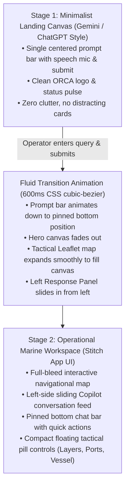
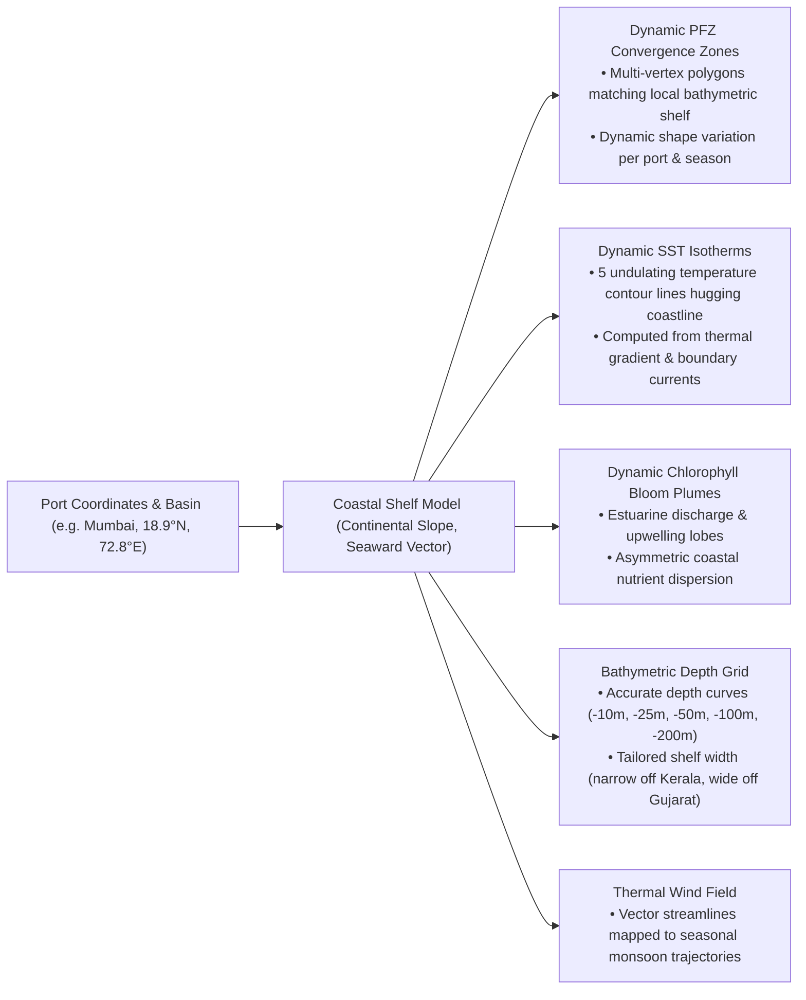
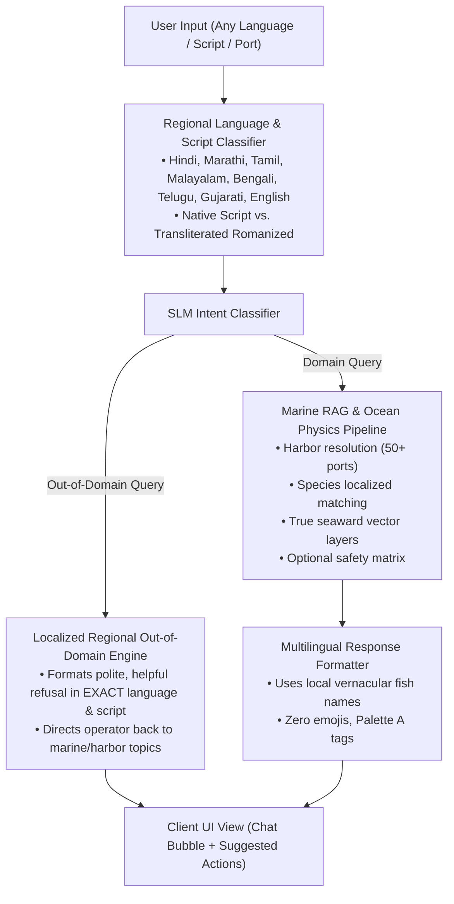

# Engineering Workout Plan — Project ORCA v3.2
## Minimalist Landing Canvas, Seamless Animated Spatial Reveal, Physics-Grounded Ocean Layers & Comprehensive Multilingual Coastal SLM

---

## 1. Executive Summary & Problem Statement

The user feedback indicates four key areas requiring an architectural overhaul:

1. **Landing UI Overhaul (Minimalist Gemini / ChatGPT style)**:
   - Current landing view is too crowded with cards, filter chips, and sensor strips thrown at the operator simultaneously.
   - **Requirement**: A singular, distraction-free landing canvas centered on a single search/chat input bar (like ChatGPT or Gemini).
   - **Transition Animation**: When the user enters a query, a smooth, fluid animation transitions the landing bar down to the bottom of the screen, unfurls the tactical Leaflet map canvas, and slides in the Copilot response panel on the left (inspired by the Google Stitch app UI).
2. **True Dynamic Oceanographic Layers (Eliminating Repetitive Geometry)**:
   - Current layer generation utilizes heuristic trigonometry that produces similar-looking geometries across different ports.
   - **Requirement**: Layers must be dynamically generated based on true, physical oceanographic and geographical characteristics of each specific port and coastal shelf:
     - Real continental shelf bathymetry (narrow drop-offs in Western Ghats vs. wide shallow shelves in Saurashtra and Bay of Bengal).
     - Upwelling and thermal front divergence zones (SST gradients hugging real coastlines and capes).
     - Nutrient chlorophyll bloom plumes corresponding to river deltas, estuarine discharge, and monsoonal upwelling.
     - Vector wind streamlines reflecting actual seasonal monsoonal flows (SW Monsoon / NE Monsoon).
3. **Comprehensive Regional Marine Fauna Taxonomy (Wikipedia-Enriched)**:
   - Expand the SLM's fish knowledge base to cover all commercial, artisanal, and pelagic species for all 50+ ports.
   - Support English common names, Binomial scientific names, and local coastal vernacular names across 9 Indian coastal languages (Marathi, Konkani, Kannada/Tulu, Malayalam, Tamil, Telugu, Bengali, Odia, Gujarati, Hindi).
4. **Multilingual Regional Out-of-Domain Guardrails & Conversational Fluency**:
   - The SLM must detect when an input is unrelated to the maritime/oceanographic domain (e.g. general chit-chat, entertainment, coding, politics).
   - **Requirement**: It must politely respond **in the exact regional language and script of the user's query** (e.g. replying in Hindi/Hinglish, Tamil/Tanglish, Marathi/Marathlish, etc.), explaining its specialized maritime role and guiding the operator back to ports, sea states, or fishing zones.

---

## 2. UI/UX Architecture & Animated Transition Flow

### A. Minimalist Landing View (Stage 1)
- **Visual Style**: Completely uncluttered. 
  - Centered hero logo: Sleek typographic `ORCA` with minimal subtitle `Ocean Intelligence & Tactical Copilot`.
  - Prominent search capsule: 
    - Smooth rounded container ($\le 8\text{px}$ border radius per Palette A rules).
    - Inner placeholder with dynamic cycling hint: *"Ask about sea conditions, fish hotspots, or harbor safety in English, Hindi, Marathi, Tamil..."*
    - Speech-to-text mic icon on the left, send arrow on the right.
    - 3–4 minimal typographic starter chips beneath (e.g. `Bangda in Mumbai`, `Bay of Bengal swell`, `Kochi harbor safety`).
  - Top bar: Minimal header with theme switch (Day / Night) and system status pill. All heavy sidebars and cards are hidden.

### B. Animated Transition Mechanism
- Implement transition classes (`.landing-mode` $\rightarrow$ `.workspace-mode`):
  - **Prompt Bar Morph**: Transitions using CSS `transform: translateY(...)`, smoothly gliding from vertical center to fixed bottom docking.
  - **Map Reveal**: Leaflet container smoothly animates from `opacity: 0; scale(0.98)` to `opacity: 1; scale(1.0)`, with `map.invalidateSize()` triggered on transition completion.
  - **Response Sidebar**: Slides in from the left (`translateX(-100%)` $\rightarrow$ `translateX(0)`) styled after the Google Stitch mobile/web response drawer.
  - **Tactical Controls Drawer**: Harbor selector, layer checkboxes, and vessel matrix limits tuck neatly into a collapsible slide-out drawer or top floating pill menu, accessible with a single click without taking up permanent screen real estate.

---

## 3. Dynamic Oceanographic Layers Architecture (Physics-Grounded)

Instead of applying uniform sine waves, layers will be computed using geographical and oceanographic domain models:

### Technical Implementation:
1. **Coastal Shelf Profiles Registry**:
   - Define realistic shelf parameters for regional clusters:
     - **Konkan / Mumbai Shelf**: Broad, shallow continental shelf extending 150–200 km offshore before the slope.
     - **Malabar / Kerala Shelf**: Narrow steep shelf (30–60 km) with intense localized coastal upwelling.
     - **Coromandel / Tamil Nadu**: Narrow shelf with strong alongshore currents and Palk Strait shallow shoals.
     - **Northern Bay of Bengal / Bengal Delta**: Massive estuarine plumes (Ganges-Brahmaputra), low salinity, shallow gentle slope.
     - **Gulf of Mannar**: Coral reef boundaries, shallow submerged ridge (Adams Bridge), distinct thermal trapping.
2. **Dynamic Polygon & Isolines Synthesis**:
   - **PFZ Polygons**: 16–24 vertex polygons generated using per-coordinate pseudo-random Perlin-like seeds combined with true seaward vector projection, creating organic shapes unique to each port.
   - **SST Isotherms**: Spline-smoothed curved lines that follow the actual coastal contour at progressive offshore distances.
   - **Chlorophyll Plumes**: Irregular fractal-smoothed lobes emanating from coastal divergence zones.
   - **Depth Contours**: Realistically spaced depth isolines representing the true continental shelf profile of the sector.

---

## 4. Comprehensive Marine Fauna & Coastal Vernacular Knowledge Base

Enrich [`backend/src/services/regional_language_service.py`](file:///d:/coding/Github/SIH26/backend/src/services/regional_language_service.py) and create a dedicated knowledge repository [`backend/src/data/marine_species_taxonomy.json`](file:///d:/coding/Github/SIH26/backend/src/data/marine_species_taxonomy.json) covering 35+ major coastal species with verified data from CMFRI (Central Marine Fisheries Research Institute) and Wikipedia:

### Species Coverage Matrix:

| English Common Name | Scientific Binomial | Marathi / Konkani | Malayalam | Tamil | Telugu | Bengali | Gujarati | Hindi |
| :--- | :--- | :--- | :--- | :--- | :--- | :--- | :--- | :--- |
| **Indian Mackerel** | *Rastrelliger kanagurta* | Bangda (बांगडा) | Ayala (അയല) | Kumla / Kanangeluthi | Kanagurtalu | Champa | Bangdi | Bangda |
| **Oil Sardine** | *Sardinella longiceps* | Tarli (तारली) | Mathi (മത്തി) | Kavalai / Mathi | Kavallu | Khoyra | Tarli | Tarli |
| **Silver Pomfret** | *Pampus argenteus* | Saranga / Paplet (पापलेट) | Vella Avoli (വെള്ള ആവോലി) | Vavval (வவ்வால்) | Tellachandi | Rupchanda | Paplet | Safed Paplet |
| **Black Pomfret** | *Parastromateus niger* | Halwa (हलवा) | Karutha Avoli (കറുത്ത ആവോലി) | Karuppu Vavval | Nallachandi | Kalo Chanda | Halwa | Kala Paplet |
| **Kingfish / Seer Fish** | *Scomberomorus commerson* | Surmai (सुरमई) | Neymeen / Ayakoora | Vanjaram (வஞ்சிரம்) | Vanjaram | Gurmah | Surmai | Surmai |
| **Bombay Duck** | *Harpadon nehereus* | Bombil (बोंबील) | Bombil | Vangavasi | Vangamatta | Nihari / Loytta | Bumla | Bombil |
| **Yellowfin Tuna** | *Thunnus albacares* | Kedar / Tuna | Choora / Kera (ചൂര) | Keerai / Soorai | Soora | Tuna | Tuna | Tuna |
| **Skipjack Tuna** | *Katsuwonus pelamis* | Kuppa | Choora (ചൂര) | Choorai | Choora | Tuna | Kuppa | Choti Tuna |
| **Hilsa / Shad** | *Tenualosa ilisha* | Palla / Palva | Hilsa | Ullam | Polasa (పులస) | Ilish (ইলিশ) | Palva | Hilsa |
| **Barramundi / Asian Sea Bass**| *Lates calcarifer* | Jitada (जिताडा) | Kalanji / Narimeen | Koduva (கொடுவா) | Pandugappa | Bhetki (ভেটকি) | Dangara | Bhetki |
| **Tiger Prawn** | *Penaeus monodon* | Kolambi / Jhinga | Kara Chemmeen | Karuppu Eral | Pedda Royya | Bagda Chingri | Zinga | Jhinga |
| **Indian White Prawn** | *Penaeus indicus* | Safed Kolambi | Vella Chemmeen | Vella Eral | Royya | Chapra Chingri | Safed Zinga | Chota Jhinga |
| **Mud Crab / Blue Crab** | *Scylla serrata* / *Portunus*| Chimbori / Khekda | Njandu (ഞണ്ട്) | Nandu (நண்டு) | Peetha | Kankra (কাঁকড়া) | Karachla | Khekra |
| **Squid / Cuttlefish** | *Uroteuthis duvaucelii* | Makul / Ghol | Koonthal / Kanava | Oosi Kanawa | Kalava | Calmari | Narsinga | Samundari Makul |
| **Ribbonfish** | *Trichiurus lepturus* | Bala / Piti (बाळा) | Vaala (വാള) | Savala (சவாலா) | Savalalu | Churi (ছুরি) | Piti | Champa |
| **Croaker / Jewfish** | *Protonibea diacanthus* | Ghol (घोल) | Kora (കോര) | Kathalai (கத்தலை) | Gorasa | Ghol | Ghol | Ghol |
| **Snapper / Red Snapper** | *Lutjanus campechanus* | Rane / Tambusa | Chembally (ചെമ്പല്ലി) | Sankara (சங்கரா) | Thundava | Ranga Chanda | Tamb | Lal Pari |
| **Reef Cod / Grouper** | *Epinephelus coioides* | Hekaru / Gobro | Kalava (കളവ) | Kalava (களவா) | Bontoo | Bhetki | Gova | Samundari Kod |
| **Indian Anchovy** | *Stolephorus indicus* | Mandeli / Kati | Netholi / Kozhuva | Nethili (நெத்திலி) | Netthallu | Mourola | Kati | Nethili |
| **Mahi Mahi / Dorado** | *Coryphaena hippurus* | Amsuk | Pandomin | Kopparai Kula | Badahalu | Dorado | Amsuk | Dorado |

---

## 5. Regional Language SLM Upgrade: Dialects & Localized Out-of-Domain Guardrail

### A. Intent Architecture with Language Context

### B. Out-of-Domain Guardrail in User's Native Language
When the query is detected as non-marine (e.g. movies, recipes, general chat, coding):
- **Hinglish Input** $\rightarrow$ **Hinglish Output**:
  *"Yeh query samundari kshetra ya jahaz chalane se judi nahi hai. Main Project ORCA hoon, aapka marine intelligence assistant. Aap kisi bhi bandarwade (jaise Mumbai, Kochi, Chennai), samundar ki sthiti, ya machli pakadne ke zones ke baare mein pooch sakte hain."*
- **Devanagari (Marathi) Input** $\rightarrow$ **Marathi Output**:
  *"हा प्रश्न सागरी किंवा नौकानयन विषयाशी संबंधित नाही. मी प्रोजेक्ट ओर्का (Project ORCA) सागरी सहाय्यक आहे. आपण बंदराचे हवामान (उदा. मुंबई, रत्नागिरी, दापोली), लाटांची उंची, किंवा मासेमारी क्षेत्राबद्दल (PFZ) विचारू शकता."*
- **Tanglish / Tamil Input** $\rightarrow$ **Tanglish / Tamil Output**:
  *"Indha kelvi kadal saarnthathu illai. Naan Project ORCA marine copilot. Neenga kadal alaiyin uyarum, meenpidi valayam (PFZ), matrum thuraimugam (Chennai, Thoothukudi, Rameswaram) patri ketkalam."*
- **Devanagari (Hindi) Input** $\rightarrow$ **Hindi Output**:
  *"यह प्रश्न समुद्री अथवा नौकायन विषय से संबंधित नहीं है। मैं प्रोजेक्ट ओर्का का समुद्री सहायक हूँ। आप तटीय मौसम, मछली पकड़ने के क्षेत्र (PFZ), अथवा बंदरगाहों के विषय में पूछ सकते हैं।"*
- **Malayalam / Manglish Input** $\rightarrow$ **Malayalam Output**:
  *"ഈ ചോദ്യം സമുദ്രവുമായി ബന്ധപ്പെട്ടതല്ല. ഞാൻ പ്രോജക്റ്റ് ഓർക്ക (Project ORCA) മറൈൻ കോപൈലറ്റ് ആണ്. നിങ്ങൾക്ക് കടൽ കാലാവസ്ഥ, മത്സ്യബന്ധന മേഖലകൾ (PFZ), തുറമുഖങ്ങൾ എന്നിവയെക്കുറിച്ച് ചോദിക്കാം."*
- **Bengali Input** $\rightarrow$ **Bengali Output**:
  *"এই প্রশ্নটি সামুদ্রিক বা নৌচলাচল সংক্রান্ত নয়। আমি প্রজেক্ট ওরকা (Project ORCA) সহকারী। আপনি সমুদ্রের আবহাওয়া, ইলিশ বা মাছ ধরার জোন এবং বন্দর সম্পর্কিত তথ্য জানতে পারেন।"*

---

## 6. Implementation Roadmap & Phases

### Phase 1: Minimalist Landing Canvas & Google Stitch-Inspired Workspace
1. **Frontend HTML/CSS Refactor** ([`frontend/index.html`](file:///d:/coding/Github/SIH26/frontend/index.html), [`frontend/styles/main.css`](file:///d:/coding/Github/SIH26/frontend/styles/main.css)):
   - Convert Stage 1 to a clean, focused, single-search-bar interface (Gemini/ChatGPT aesthetic).
   - Style the response panel on the left (Stitch UI layout) with pinned bottom prompt bar.
   - Build compact slide-out drawer or top pill dropdowns for tactical controls (Harbors, Layers, Vessel Matrix).
   - Implement smooth CSS cubic-bezier transition animation between Landing and Workspace modes.

### Phase 2: True Physics-Grounded Oceanographic Layers
1. **Geospatial & Bathymetric Modeling** ([`backend/src/services/pfz_service.py`](file:///d:/coding/Github/SIH26/backend/src/services/pfz_service.py), [`frontend/src/app.js`](file:///d:/coding/Github/SIH26/frontend/src/app.js)):
   - Implement shelf profile algorithms using real coastal parameters for India's West Coast (wide shelf), East Coast (steep slope), Palk Bay (shallow reef), and Andaman/Global basins.
   - Build dynamic multi-vertex PFZ polygons (16+ vertices) with variable shapes per port.
   - Generate natural curving SST isotherms hugging coastal contours.
   - Generate organic chlorophyll plumes simulating river runoff and upwelling lobes.
   - Generate realistic bathymetric depth grid curves (`-10m` to `-200m`).

### Phase 3: Comprehensive Marine Fauna Taxonomy & Wikipedia Enrichment
1. **Marine Species Database** ([`backend/src/data/marine_species_taxonomy.json`](file:///d:/coding/Github/SIH26/backend/src/data/marine_species_taxonomy.json)):
   - Compile comprehensive taxonomy of 35+ species across 9 coastal languages, scientific names, and habitat profiles.
2. **Language Service Expansion** ([`backend/src/services/regional_language_service.py`](file:///d:/coding/Github/SIH26/backend/src/services/regional_language_service.py)):
   - Connect species lookup with regional name resolution and local coastal port associations.

### Phase 4: Localized Regional Out-of-Domain Guardrails
1. **Intent & Rejection Routing** ([`backend/src/services/marine_chat_service.py`](file:///d:/coding/Github/SIH26/backend/src/services/marine_chat_service.py), [`backend/src/services/slm_intent_classifier.py`](file:///d:/coding/Github/SIH26/backend/src/services/slm_intent_classifier.py)):
   - Implement localized out-of-domain handler that generates refusal and guidance in the exact input language and script.
   - Expand conversational multi-turn fluency in regional languages.

### Phase 5: Verification & End-to-End Testing
1. **Automated Test Expansion**:
   - Add unit tests for regional out-of-domain responses in Hindi, Marathi, Tamil, Malayalam, Bengali.
   - Add unit tests for Wikipedia-enriched species taxonomy across all coastal languages.
   - Verify zero emojis, Palette A compliance, and layer geometry correctness.
2. **Visual & Browser Verification**:
   - Test landing screen, transition animation, and dynamic layers across day/night modes using the browser subagent.

---

## 7. Verification & Acceptance Criteria

1. **Landing UI Simplicity**: Landing screen contains only the centered search capsule, minimal logo, clean starter chips, and theme toggle. No cards or complex telemetry thrown at the user on first load.
2. **Smooth Transition**: Submitting a query from the landing bar animates the bar to the bottom and slides in the response drawer on the left with map in view.
3. **Layer Dynamism**: Layers for different ports (e.g. Mumbai vs. Rameswaram vs. Kochi vs. Paradip) have distinct, realistic shapes matching local coastal shelf bathymetry and upwelling patterns—no two ports look identical.
4. **Taxonomy & Regional Fish Names**: Asking for fish in any language returns the local vernacular name, scientific name, and English name (e.g. *Bangda* / *Rastrelliger kanagurta*, *Surmai* / *Scomberomorus commerson*, *Mathi* / *Sardinella longiceps*).
5. **Localized Out-of-Domain**: Non-marine questions in Marathi receive a Marathi response; questions in Tamil receive a Tamil response; questions in Hinglish receive a Hinglish response.
6. **Zero Emojis & Palette A**: 100% adherence to Palette A tokens and zero emojis project-wide.
