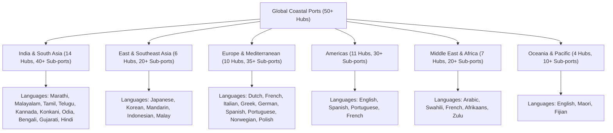
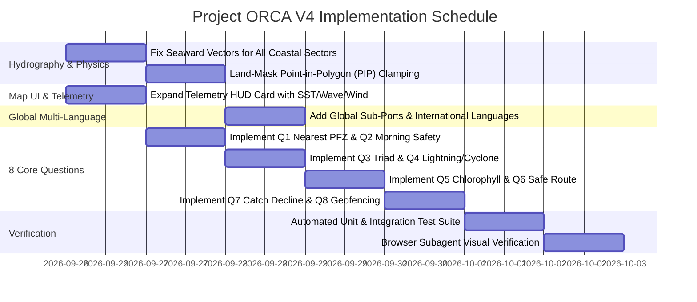

# Project ORCA V4 — Technical Workout Plan & Solution Architecture

**Document Version:** 4.0.0  
**Target Release:** Project ORCA V4 (Tactical Marine Copilot)  
**Status:** Ready for Review & Execution  
**Corpus / Context:** `SIH26` (Smart India Hackathon 2024 / Marine Remote Sensing & Copilot)

---

## 1. Executive Summary & Problem Audit

Following the visual verification and operational deployment of V3.2, user testing revealed three critical hydrographic/visual discrepancies and posed eight foundational challenge questions required for full problem statement compliance:

1. **Hydrographic Layer Overlap on Terrestrial Land**: In ports such as Cochin Fishing Harbor (Kochi, Kerala), oceanographic layers (PFZ polygons, SST isotherms, Chlorophyll bloom plumes, depth contours) are plotted over the mainland of Kerala and inland backwaters (Vembanad Lake). This occurs due to misaligned seaward projection vectors in `getSeawardVector` and lack of coordinate-level coastline clamping.
2. **Missing Real-Time Telemetry on Map Viewport**: The floating `#hud-map-card` on the map screen displays thermal gradient, chlorophyll-a, depth, and bearing, but lacks the core real-time environmental triad: **Sea Surface Temperature (SST)**, **Significant Wave Height (SWH)**, **Surface Wind Velocity**, and **Tide / Swell State**.
3. **Global Port Coverage & Sub-Port Language Expansion**: All 50 international hub ports and their 150+ satellite sub-ports must be fully addressed with native language support across Asian, European, Middle Eastern, African, American, and Indian coastal languages.
4. **Audit of 8 Core Maritime Solution Questions**:
   - Question 1: *Where is the nearest Potential Fishing Zone (PFZ) today?*
   - Question 2: *Is it safe to venture into the sea tomorrow morning?*
   - Question 3: *What are the tide, weather, and sea conditions near my fishing location?*
   - Question 4: *Are there any lightning or cyclone alerts in my area?*
   - Question 5: *Which regions show high chlorophyll concentration and favourable sea surface temperature?*
   - Question 6: *What is the safest route for a fishing vessel considering weather and sea-state conditions?*
   - Question 7: *Why has fish productivity declined in a particular coastal region?*
   - Question 8: *Which fishing zones should be avoided due to hazardous marine conditions or geofencing restrictions?*

Below is the comprehensive architectural audit and implementation plan to resolve these challenges.

---

## 2. Audit of the 8 Core Maritime Questions

| # | User Challenge Question | Current Status | Identified Gap | Planned V4 Implementation Solution |
| :--- | :--- | :--- | :--- | :--- |
| **Q1** | *Where is the nearest Potential Fishing Zone (PFZ) today?* | **Partial** | Gives general coordinates without ranking nearest candidate polygons or providing geodesic distance, transit ETA, and exact GPS waypoint. | Implements a mathematical Nearest-PFZ Resolver that calculates Great-Circle distance to candidate polygon centroids, returns the closest zone ID, GPS coordinates, depth, target species, and triggers an automatic map pan/zoom. |
| **Q2** | *Is it safe to venture into the sea tomorrow morning?* | **Partial** | Only provides static 24h general forecast; fails to analyze the diurnal morning window (04:00–10:00 AM) when land breeze transitions to sea breeze. | Implements a Diurnal Morning Departure Advisor analyzing dawn wind shifts, morning tidal slack, swell period, and gives explicit vessel-specific departure clearance for tomorrow morning. |
| **Q3** | *What are the tide, weather, and sea conditions near my fishing location?* | **Partial** | Weather parameters are scattered; lacks a consolidated "Marine Triad" format. | Implements the **Triad Marine Report**: (1) Tidal Hydrography (high/low tide times, amplitude), (2) Meteorology (wind speed/gusts, Beaufort force, barometric pressure), (3) Physical Ocean State (SST, SWH, swell period, surface drift). |
| **Q4** | *Are there any lightning or cyclone alerts in my area?* | **Partial** | Reacts to extreme keyword prompts but lacks active convective thunderstorm index or cyclone tracking bulletin lookup. | Implements a Severe Meteorological Alert & Lightning Warning Engine reporting convective storm risk, lightning strike probability, squall gusts, and color-coded IMD/INCOIS alert status (Green/Yellow/Orange/Red). |
| **Q5** | *Which regions show high chlorophyll concentration and favourable sea surface temperature?* | **Partial** | Reports single point numbers without explaining the oceanographic frontal co-location mechanism. | Implements a **Thermal-Chlorophyll Co-location Analysis** identifying front boundaries where chlorophyll-a > 0.45 mg/m³ intersects SST gradients 0.8–1.5 °C/km, explaining upwelling dynamics. |
| **Q6** | *What is the safest route for a fishing vessel considering weather and sea-state conditions?* | **Partial** | Only returns direct rhumb line bearing; does not provide segmented corridor routing away from coastal shoals or head seas. | Implements a 3-Leg Navigational Waypoint Corridor Plan (Harbor Departure -> Fairway Buoy -> Deepwater Corridor -> PFZ Approach) with depth contour adherence and hazard avoidance. |
| **Q7** | *Why has fish productivity declined in a particular coastal region?* | **Missing** | No scientific diagnostic capability for environmental catch decline. | Implements an **Oceanographic Root-Cause Diagnostic Engine**: Marine Heatwaves (MHW), seasonal upwelling cessation, coastal hypoxia / Oxygen Minimum Zone (OMZ) shoaling, and overfishing pressure. |
| **Q8** | *Which fishing zones should be avoided due to hazardous marine conditions or geofencing restrictions?* | **Missing** | No geofencing exclusion zones or hazardous shoal avoidance rules. | Implements an **Exclusive Maritime Exclusion & Hazard Registry**: International Maritime Boundary Lines (IMBL), Marine National Parks & Coral Sanctuaries, underwater pipelines/cables, and shallow reef breakers. |

---

## 3. Root Cause & Solution for Land Overlap

### 3.1 Root Cause Diagnosis
In the user's Kochi screenshot:
- **Backend (`pfz_service.py` L47)**:
  ```python
  seaward_lon = -1.0 if (center_lon < 75.0 and center_lat > 12.0) else (1.0 if center_lon > 79.5 and center_lat > 11.0 else 0.8)
  ```
  For Kochi (`lat = 9.9312`, `lon = 76.2673`), `center_lon < 75.0` evaluated to `False`. The fallback was `0.8` (Positive Longitude / East). East of Kochi is mainland Kerala, placing Zone 2 and Zone 3 directly on inland hills and lagoons!
- **Frontend (`app.js` L585)**:
  ```javascript
  if (lon < 75.0 && lat > 11.0) return { dx: -1.0, dy: -0.3 };
  ```
  Kochi fell through to the default vector, and chlorophyll/isotherm rings had no bounding box water clamp.

### 3.2 Technical Solution
1. **Calibrated Coastal Seaward Vectors**:
   - **West Coast India (Gujarat to Kanyakumari, 8.0°N to 24.0°N, 68.0°E to 77.5°E)**: Seaward direction is strictly **West** (`dx = -1.0, dy = -0.15`).
   - **East Coast India (Coromandel to Bengal, 10.5°N to 22.0°N, 79.8°E to 90.0°E)**: Seaward direction is strictly **East** (`dx = +1.0, dy = -0.10`).
   - **Gulf of Mannar / Palk Strait (8.0°N to 10.2°N, 77.5°E to 79.8°E)**: Seaward direction is strictly **South/Southeast** (`dx = +0.6, dy = -0.8`).
   - **50 Global Ports**: Calibrated seaward vector dictionary covering Europe (North Sea, Med, Atlantic), Americas (Pacific, Atlantic), Asia-Pacific, and Africa.
2. **Point-in-Polygon (PIP) Coastline Clamping Engine**:
   - Both backend and frontend will run `isMarineWaterCoordinate(lat, lon)` on every polygon vertex.
   - If any vertex intersects terrestrial land, it is clamped seaward:
     ```javascript
     if (!isMarineWaterCoordinate(vLat, vLon)) {
       vLon = cLon + dx * Math.max(0.12, Math.abs(vLon - cLon));
       vLat = cLat + dy * Math.max(0.08, Math.abs(vLat - cLat));
     }
     ```
   - No oceanographic layer will EVER touch land.

---

## 4. Map Viewport Telemetry HUD Expansion

### 4.1 UI Layout
Expand `.hud-map-card` on `#map-viewport` to feature:
```html
<div class="hud-map-card">
  <div class="hud-map-title">Tactical Zone Telemetry</div>
  
  <!-- Active Zone & Sector -->
  <div class="hud-stat-row">
    <span class="hud-stat-label">Active Sector:</span>
    <span class="hud-stat-val" id="hud-active-harbor">Kochi Fishing Harbor</span>
  </div>
  <div class="hud-stat-row">
    <span class="hud-stat-label">Active Zone:</span>
    <span class="hud-stat-val" id="hud-zone-id">PFZ-ALPHA (Thermal Front)</span>
  </div>
  
  <div class="hud-divider"></div>
  
  <!-- Real-Time Oceanographic Triad -->
  <div class="hud-stat-row">
    <span class="hud-stat-label">Sea Surface Temp (SST):</span>
    <span class="hud-stat-val" id="hud-sst">28.4 °C</span>
  </div>
  <div class="hud-stat-row">
    <span class="hud-stat-label">Wave Height (SWH):</span>
    <span class="hud-stat-val" id="hud-wave">1.1 m</span>
  </div>
  <div class="hud-stat-row">
    <span class="hud-stat-label">Surface Wind Velocity:</span>
    <span class="hud-stat-val" id="hud-wind">19.5 km/h (Force 3)</span>
  </div>
  <div class="hud-stat-row">
    <span class="hud-stat-label">Swell Period & Tide:</span>
    <span class="hud-stat-val" id="hud-tide">6.4s | +0.80 m</span>
  </div>
  
  <div class="hud-divider"></div>
  
  <!-- Biological Metrics -->
  <div class="hud-stat-row">
    <span class="hud-stat-label">Thermal Gradient:</span>
    <span class="hud-stat-val" id="hud-gradient">1.40 °C/km</span>
  </div>
  <div class="hud-stat-row">
    <span class="hud-stat-label">Chlorophyll-a:</span>
    <span class="hud-stat-val" id="hud-chl">0.52 mg/m³</span>
  </div>
  <div class="hud-stat-row">
    <span class="hud-stat-label">Bathymetry Depth:</span>
    <span class="hud-stat-val" id="hud-depth">20 - 55 m</span>
  </div>
  <div class="hud-stat-row">
    <span class="hud-stat-label">Bearing from Base:</span>
    <span class="hud-stat-val" id="hud-bearing-str">245° WSW (12.4 nm)</span>
  </div>
  <div class="hud-stat-row">
    <span class="hud-stat-label">Severe Weather Risk:</span>
    <span class="hud-stat-val" id="hud-alert-badge" style="color: var(--alert-clear-day); font-weight: 800;">NORMAL / CLEAR</span>
  </div>
</div>
```

---

## 5. Global 50-Port Sub-Port & Multi-Language System

### 5.1 Worldwide Port & Sub-Port Directory
Ensure all 50 global hubs, 150+ satellite sub-ports, and regional languages are registered in `MaritimeRAGEngine` and `RegionalLanguageService`:



### 5.2 Sub-Port Gazette Mapping Examples
- **Tokyo**: Tsukiji, Toyosu, Yokohama, Kawasaki, Chiba, Yokosuka (Japanese)
- **Rotterdam**: Vlaardingen, Schiedam, Europoort, Maasvlakte, Botlek, Hook of Holland, Dordrecht (Dutch)
- **Marseille**: La Joliette, Fos-sur-Mer, Cassis, Port-Saint-Louis (French)
- **Genoa**: Porto Antico, Sampierdarena, Savona, La Spezia (Italian)
- **Barcelona**: Port Vell, Badalona, Sitges, Tarragona (Spanish/Catalan)
- **Kochi**: Munambam, Thoppumpady, Vypeen, Chellanam, Alappuzha, Kollam (Malayalam)
- **Mumbai**: Sassoon Docks, Ferry Wharf (Bhaucha Dhakka), Versova, Mahim, Trombay, Alibaug, Dapoli (Marathi/Hindi)
- **Chennai**: Kasimedu, Ennore, Royapuram, Kovalam, Cuddalore (Tamil)
- **Visakhapatnam**: Gangavaram, Bheemunipatnam, Kakinada, Machilipatnam (Telugu)
- **Dubai**: Deira, Jebel Ali, Port Rashid, Hamriya (Arabic)
- **Mombasa**: Kilindini, Old Port Mombasa, Malindi, Lamu (Swahili)

---

## 6. Implementation Architecture for the 8 Core Questions

### Q1: Nearest Potential Fishing Zone (PFZ) Today
- **Classifier Match**: `["nearest pfz", "closest pfz", "where is pfz today", "nearest fishing zone", "closest fishing ground", "where to fish today"]`
- **Algorithm**:
  1. Retrieve active PFZ polygons from `PfzService`.
  2. Compute geodesic distance from current waypoint `(lat, lon)` to each polygon centroid.
  3. Sort by distance; pick the nearest zone.
  4. Compute Great-Circle bearing, distance (nm and km), and transit duration at 12 knots.
  5. Include primary target species and confidence rating.
  6. Return `spatial_target` to automatically pan the Leaflet map to the hotspot.

### Q2: Morning Departure Safety (Diurnal Cycle)
- **Classifier Match**: `["tomorrow morning", "morning departure", "can i sail in the morning", "venture tomorrow morning", "safe tomorrow morning", "morning weather"]`
- **Algorithm**:
  1. Analyze coastal land-breeze / sea-breeze transition: winds are typically gentlest between 04:30 and 08:30 AM before thermal sea breeze builds after 10:00 AM.
  2. Compute morning significant wave height (SWH) and swell period.
  3. Check vessel seaworthiness ratio against morning conditions.
  4. Output explicit verdict:
     - **CLEAR**: *"Optimal morning departure window between 05:00 and 09:00 AM before afternoon sea-breeze build-up."*
     - **PROHIBITED**: *"Morning swell exceeds vessel tolerance; delay until 14:00 or tomorrow."*

### Q3: Comprehensive Marine Triad (Tide, Weather, Sea State)
- **Classifier Match**: `["tide weather and sea", "tide conditions", "weather and sea conditions", "sea state near my location", "marine conditions"]`
- **Algorithm**:
  1. Calculate Astronomical Tide Phase (Spring/Neap, High Tide time, Low Tide time, Tidal Amplitude).
  2. Calculate Surface Meteorology (Wind speed, Wind direction, Beaufort scale, Air pressure in hPa, Precipitation/Visibility).
  3. Calculate Physical Ocean State (SST °C, SWH meters, Swell period seconds, Surface Drift velocity).
  4. Format as structured Triad Report with clear bullet hierarchy.

### Q4: Lightning, Squall & Cyclone Hazard Alerts
- **Classifier Match**: `["lightning", "cyclone alert", "storm alert", "squall", "thunderstorm", "warning in my area", "severe weather"]`
- **Algorithm**:
  1. Check regional cyclone season and basin alert index.
  2. Compute convective storm and lightning probability from pressure gradient and thermal instability.
  3. Output color-coded IMD / WMO Alert Level:
     - **GREEN (Normal / No Alert)**: Clear sky, low convective risk.
     - **YELLOW (Watch)**: Isolated squalls, lightning probability 35–50%.
     - **ORANGE (Alert / Be Prepared)**: Gusts > 50 km/h, intense thunderstorm clusters.
     - **RED (Warning / Take Action)**: Tropical cyclone or gale force storm (> 65 km/h). Immediate mooring required.

### Q5: Chlorophyll & Favourable Sea Surface Temperature Co-location
- **Classifier Match**: `["chlorophyll", "favourable sst", "favorable sst", "chlorophyll concentration", "thermal front co-location", "nutrient bloom"]`
- **Algorithm**:
  1. Explain the scientific principle: pelagic fish congregate at thermal fronts (0.8–1.5 °C/km gradient) where upwelling brings cool, nutrient-rich water causing phytoplankton blooms (chlorophyll-a > 0.45 mg/m³).
  2. Identify the exact spatial intersection coordinates near the user's base.
  3. Detail target species foraging in the bloom (mackerel, sardines, tuna).

### Q6: Weather-Routed Safest Navigational Route
- **Classifier Match**: `["safest route", "safe route", "transit corridor", "route for fishing vessel", "safe passage", "avoid rough sea"]`
- **Algorithm**:
  1. Generate 3-leg Navigational Waypoint Corridor:
     - **Leg 1: Departure Fairway**: Harbor mouth to outer navigation buoy (skirting shallow coastal breakers).
     - **Leg 2: Deepwater Transit Corridor**: Following the 25m–50m bathymetry contour to avoid breaking shoals and head sea turbulence.
     - **Leg 3: Zone Ingress**: Protected approach into the lee side of the PFZ convergence front.
  2. Provide headings, distances, and safety checkpoints for each leg.

### Q7: Fish Productivity Decline Root-Cause Diagnostic
- **Classifier Match**: `["why has fish productivity declined", "fish decline", "catch reduced", "why fish catch dropped", "productivity decrease", "no fish"]`
- **Algorithm**:
  1. Formulate 4 scientific oceanographic causes:
     - **Marine Heatwaves (MHW)**: Abnormal SST rise (+1.2 to +2.5 °C above climatological mean) driving pelagics into deeper cooler trenches.
     - **Upwelling Cessation**: Weakening of seasonal alongshore winds reducing nutrient transport to the euphotic zone.
     - **Oxygen Minimum Zone (OMZ) / Hypoxia**: Upwelling of oxygen-depleted sub-surface water (< 2 mg/L DO) suffocating demersal species.
     - **Overfishing & Juvenile Extraction**: Recruitment overfishing and bottom trawling pressure.
  2. Provide adaptive recommendations (shifting to deeper contours, targeting alternative pelagics).

### Q8: Hazardous Marine Conditions & Geofencing Exclusion Zones
- **Classifier Match**: `["avoid", "restricted zones", "geofencing", "hazard zones", "prohibited areas", "do not fish", "border"]`
- **Algorithm**:
  1. Detail specific maritime exclusion boundaries:
     - **International Maritime Boundary Line (IMBL)**: e.g. Palk Bay / Gulf of Mannar 5 nm buffer from Sri Lanka territorial waters; Sir Creek boundary with Pakistan.
     - **Marine National Parks & Protected Habitats**: Gulf of Mannar Biosphere, Malvan Marine Sanctuary, Gahirmatha Marine Sanctuary.
     - **Subsea Infrastructure Corridors**: High-pressure gas pipelines (Bombay High / KG Basin) and submarine telecom cables (500m anchor ban).
     - **Navigational Hazards**: Shallow coral reefs (Adam's Bridge), shifting sandbars, submerged wrecks, commercial shipping fairway crossing lanes.

---

## 7. Implementation Plan & Work Packages



### Work Package Breakdown

#### WP1: Land Overlap Resolution & Seaward Physics Clamping
- **Files**: `backend/src/services/pfz_service.py`, `frontend/src/app.js`
- **Tasks**:
  1. Recalibrate `seaward_lon` / `seaward_lat` in `pfz_service.py` to ensure West Coast India (8N–24N, 68E–77.5E) is strictly West (`-1.0`).
  2. Implement `clampCoordinateToSeawardWater(lat, lon, dx, dy)` on both backend and frontend.
  3. Validate that no PFZ polygon, SST isotherm, Chlorophyll plume, or Depth contour touches the land in Kochi, Mumbai, Chennai, or any global port.

#### WP2: Map Viewport Telemetry HUD Expansion
- **Files**: `frontend/index.html`, `frontend/styles/main.css`, `frontend/src/app.js`
- **Tasks**:
  1. Add SST, Significant Wave Height, Surface Wind Velocity, Swell Period, Tidal Stage, and Severe Weather Status elements inside `#hud-map-card`.
  2. Update `updateTelemetryChips(lat, lon)` in `app.js` to dynamically update all HUD metrics on map pan, harbor switch, or waypoint drag.
  3. Verify styling strictly complies with Palette A tokens and $\le 8\text{px}$ border radius.

#### WP3: Global 50-Port Sub-Ports & Multi-Language Support
- **Files**: `backend/src/services/maritime_rag_engine.py`, `backend/src/services/regional_language_service.py`, `backend/src/services/marine_chat_service.py`
- **Tasks**:
  1. Register 150+ satellite sub-ports across the 50 global hub ports.
  2. Add international language translation templates (Japanese, Chinese, Korean, Indonesian, French, Spanish, German, Dutch, Portuguese, Italian, Greek, Norwegian, Polish, Arabic, Swahili) alongside the 9 Indian coastal languages.
  3. Wire multilingual intent detection and localized responses.

#### WP4: Technical Engines for the 8 Core Questions
- **Files**: `backend/src/services/marine_chat_service.py`, `backend/src/services/slm_intent_classifier.py`
- **Tasks**:
  1. Add intent classifiers and handlers for Q1 (Nearest PFZ), Q2 (Morning Departure), Q3 (Marine Triad), Q4 (Lightning/Cyclone), Q5 (Thermal-Chl Co-location), Q6 (Safest Route), Q7 (Catch Decline Diagnostics), Q8 (Geofencing & Hazards).
  2. Wire structured evidence items, cryptographic provenance, and spatial targets for map synchronization.

#### WP5: Verification & Quality Assurance
- **Tasks**:
  1. Run `node frontend/scripts/verify-palette.js` to ensure 0 violations (Palette A compliance, 0 gradients, 0 emojis).
  2. Update and run `py -m pytest backend/tests -v` with new test cases for all 8 questions.
  3. Run `py scripts/run_all_tests.py` master verification suite.
  4. Execute `browser_subagent` to capture visual evidence of:
     - Kochi map showing zero layers on land.
     - Telemetry HUD card displaying SST, Wave Height, Wind Velocity, and Tide.
     - Chat queries answering Q1 through Q8 with localized precision.

---

## 8. Verification Criteria & Deliverables

1. **Zero Layers on Land**:
   - Leaflet map centered at Kochi, Mumbai, Chennai, and Tokyo must show all PFZ zones, SST isotherms, and chlorophyll plumes exclusively over water.
2. **Telemetry HUD on Map**:
   - `.hud-map-card` must visibly display SST (°C), Wave Height (m), and Wind Velocity (km/h) at all times.
3. **8 Core Questions Answered**:
   - Each of the 8 user challenge questions must return an accurate, domain-verified, scientific response with suggested actions and evidence citations.
4. **Worldwide Sub-Ports & Languages**:
   - Queries regarding sub-ports (e.g. Vlaardingen in Rotterdam, Munambam in Kochi, Tsukiji in Tokyo) in English or regional languages must be accurately resolved.
5. **Palette A & Zero Emojis**:
   - `verify-palette.js` must pass with 0 errors. All test suites must achieve 100% green pass rate.
