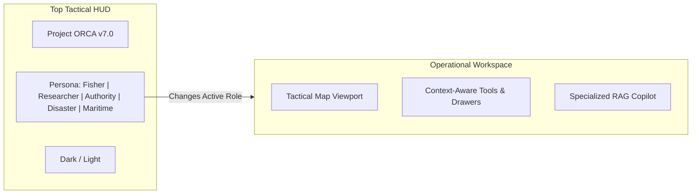
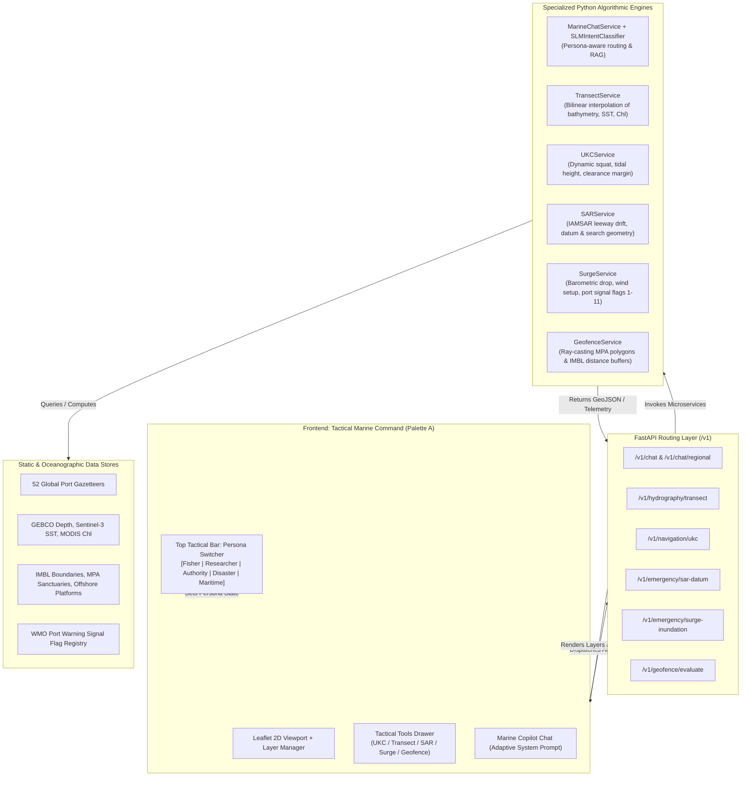

# Project ORCA — V7.0 Multi-Stakeholder Intelligence & Operational Command Architecture

## Document Overview
- **Version**: 7.0.0 (Planning & Architectural Specification)
- **Codename**: *Tethys Sentinel — Unified Multi-Stakeholder Marine Command*
- **Scope**: Specialized personas, workflows, data models, and tooling for 5 key marine stakeholder groups: Fishermen, Marine Researchers, Coastal Authorities, Disaster Management Agencies, and Commercial Maritime Operators.

---

## 1. Executive Summary & Problem Space

As Project ORCA achieved robust oceanographic data ingestion, multi-lingual SLM routing, seaward water integrity, and Google Stitch design aesthetics in Version 6, the logical evolution is **multi-stakeholder domain expansion**.

Different maritime actors operate in the exact same oceanographic space (bathymetry, waves, currents, sea surface temperature, chlorophyll fronts), yet their **operational objectives, decision risks, latency requirements, and output formats** are fundamentally distinct:
1. **Fishermen** require rapid, low-bandwidth, vernacular, fuel-efficient routing to pelagic fish hotspots with immediate safety thresholds.
2. **Marine Researchers** require high-precision scientific parameter slicing, spatial transects, historical anomaly detection, and exportable NetCDF/CSV datasets.
3. **Coastal Authorities** require regulatory enforcement, border line (IMBL) proximity monitoring, seasonal fishing ban calendars, and Search-and-Rescue (SAR) leeway drift modeling.
4. **Disaster Management Agencies** require storm surge inundation projections, cyclone wind radii quadrant mapping, port warning signal flags, and multi-channel CAP alert generation.
5. **Commercial Maritime Operators** require Under-Keel Clearance (UKC) draft safety, multi-leg waypoint route planning, bunker fuel consumption optimization, and offshore exclusion zone buffers.

Version 7 introduces the **Adaptive Stakeholder Persona Engine**, enabling Project ORCA to dynamically reconfigure its telemetry density, map visual overlays, analytical toolsets, and SLM conversational reasoning to match the exact operational role of the active user.

---

## 2. Comprehensive Stakeholder Matrix

| Stakeholder Group | Primary Operational Objective | Key Marine Inputs | Primary Risk Vector | Target Output Artifact |
| :--- | :--- | :--- | :--- | :--- |
| **1. Fishermen** | Maximize catch rate while minimizing trip diesel costs and vessel capsize risk. | PFZ zones, SST thermal fronts, wave swell, localized fish behavior, bar-crossing tide. | Swell capsize, high fuel burn on zero-catch trips, crossing International Maritime Boundary Lines (IMBL). | Vernacular voice/text advisory, 1-click compass bearing, fuel-optimized passage, hazard warnings. |
| **2. Researchers** | Quantify oceanographic dynamics, study marine heatwaves, and analyze chlorophyll-upwelling coupling. | Level-3 satellite rasters (MODIS, Sentinel-3), GEBCO 15-arcsec bathymetry, in-situ buoys, Argo floats. | Sensor calibration drift, cloud contamination artifacts, lack of reproducible raw data audit trails. | Spatial transect depth profiles, SST/Chl time-series anomaly plots, CF-compliant NetCDF/CSV exports. |
| **3. Coastal Authorities** | Safeguard maritime borders, enforce fisheries conservation laws, and coordinate marine patrol and SAR. | Vessel density/AIS, Marine Protected Area (MPA) boundaries, annual monsoon ban calendars, leeway drift. | Illegal Unreported & Unregulated (IUU) fishing, border encroachment, delayed SAR response to lost craft. | Geofence intrusion alerts, Search-and-Rescue Expanding Square datum, vessel inspection dossiers. |
| **4. Disaster Management** | Protect vulnerable coastal communities, harbors, and critical infrastructure from extreme marine hazards. | Cyclonic wind radii quadrants, tidal phase, storm surge inundation models, historical surge footprints. | Coastal flooding, delayed evacuation notices, destruction of artisanal beach landing craft. | Cyclone cone of uncertainty, inundation depth maps, port signal flag declarations, CAP alert broadcasts. |
| **5. Maritime Operators** | Ensure safe, fuel-efficient commercial transit of cargo, tugs, offshore supply vessels (OSVs), and ferries. | Navigational channels, dredged channel depths, real-time tide levels, squat effect, pilotage schedules. | Grounding in shallow dredged fairways, heavy weather structural damage, offshore rig exclusion breach. | Dynamic Under-Keel Clearance (UKC) calculator, multi-leg waypoint passages, bunker optimization curves. |

---

## 3. Detailed Stakeholder Feature Specifications & Use Cases

```mermaid
graph TD
    A["ORCA v7.0 Tactical Command Engine"] --> B["Persona 1: Fishermen"]
    A --> C["Persona 2: Researchers"]
    A --> D["Persona 3: Coastal Authorities"]
    A --> E["Persona 4: Disaster Management"]
    A --> F["Persona 5: Maritime Operators"]

    B --> B1["Fuel-Optimized PFZ Passage"]
    B --> B2["Bar-Crossing Tide Window"]
    B --> B3["IMBL Border Proximity Alert"]

    C --> C1["Hydrographic Transect Slicer"]
    C --> C2["Marine Heatwave Anomaly Detector"]
    C --> C3["NetCDF-4 & GeoTIFF Exporter"]

    D --> D1["MPA & Spawning Sanctuary Geofences"]
    D --> D2["Monsoon Ban Regulatory Calendar"]
    D --> D3["SAR Leeway Drift Modeling"]

    E --> E1["Storm Surge Coastal Inundation Extent"]
    E --> E2["Cyclone Track & Wind Radii Cones"]
    E --> E3["Port Signal Flags & CAP Dispatcher"]

    F --> F1["Dynamic Under-Keel Clearance (UKC)"]
    F --> F2["Multi-Leg Waypoint Route Optimizer"]
    F --> F3["Offshore Exclusion Zone Buffer"]
```



---

### 3.1 Stakeholder 1: Fishermen (Artisanal, Motorized Skiffs & Mechanized Fleets)

#### Core Feature Additions
1. **Fuel-Optimized PFZ Passage (ROI Engine)**:
   - Calculates estimated diesel consumption (liters) for outbound and return voyages based on vessel engine HP, displacement speed, and opposing surface current vectors.
   - Computes expected catch value vs. fuel expense to generate a net voyage ROI index.
2. **Harbor Sandbar & Estuary Tide Window Clearance**:
   - Integrates real-time tidal curves at river mouths and bar crossings (e.g. Munambam, Mirkarwada, Pamban Channel) to highlight "Safe Bar Crossing Windows" preventing keel stranding on low water.
3. **International Maritime Boundary Line (IMBL) Geofence Alerter**:
   - High-visibility nautical buffer zones along sensitive geopolitical boundaries (e.g., India-Sri Lanka Palk Bay/Gulf of Mannar, India-Pakistan Sir Creek, India-Bangladesh Swatch of No Ground).
   - Audio/visual proximity alerts when a boat's estimated course approaches within 3 nm and 1 nm of the border.
4. **Vernacular Low-Bandwidth Voice Dispatch**:
   - Lightweight audio compression rendering spoken advice in regional maritime dialects (Tamil, Marathi, Malayalam, Telugu, Bengali, Gujarati, Hindi).

#### Operational Use Cases
- **Use Case 1.1 (Artisanal OBM Boat in Palk Bay)**: A fisherman departing Rameswaram at 04:00 asks *"Where is the closest mackerel school without going near the Sri Lanka line?"*. ORCA routes the vessel 7.4 nm North-Northeast into a high-chlorophyll thermal plume while displaying a 2.5 nm safety buffer away from the IMBL.
- **Use Case 1.2 (Mechanized Trawler at Cochin Harbor)**: A 45-foot trawler crew with 150 HP inboard diesel wants to know if they can cross the Cochin bar at 15:30. ORCA checks the semi-diurnal tidal height (+1.4m above chart datum), checks the swell (1.2m at 8s), and declares: *"Clear to cross between 14:15 and 17:45. Return required before 22:30 or wait until next morning high tide."*
- **Use Case 1.3 (Dapoli Small Skiff Fuel Economy)**: Fisher asks in Marathlish: *"daryavar bangda kuthe milel diesel kami lagla pahije"*. ORCA identifies two PFZ clusters: Cluster A is 16 nm away (high density), Cluster B is 6 nm away (medium density). factoring in diesel consumption (14L vs 38L), ORCA recommends Cluster B for maximum profit margin.

---

### 3.2 Stakeholder 2: Marine Biologists & Physical Oceanographers

#### Core Feature Additions
1. **Interactive Hydrographic Spatial Transect Slicer**:
   - Tool allowing researchers to draw a linear polyline across continental shelves, shelf breaks, or coastal upwelling tongues.
   - Renders a 2D vertical profile cross-section plotting Sea Surface Temperature ($^\circ\text{C}$), Chlorophyll concentration ($\text{mg/m}^3$), and bathymetric depth ($\text{m}$) along the distance axis.
2. **Marine Heatwave (MHW) & Thermal Anomaly Detection**:
   - Compares real-time Sentinel-3 SLSTR observations with baseline climatological baselines to identify thermal anomalies ($\Delta\text{SST} > +1.5^\circ\text{C}$).
   - Generates coral reef bleaching risk warnings for sensitive ecosystems (Gulf of Mannar, Lakshadweep, Andaman Islands, Great Barrier Reef).
3. **In-Situ Sensor Fusion (Argo & Mooring Buoys)**:
   - Visual toggle displaying real-time positions and telemetry telemetry of active oceanographic buoys (INCOIS OMNI, RAMA, NOAA NDBC) and profiling Argo floats.
4. **Research-Grade Open Data Exporter**:
   - Exports the currently active bounding box as CF-compliant NetCDF-4 (`.nc`), GeoTIFF (`.tif`), or structured JSON/CSV for direct import into scientific workflows (Python `xarray`, `rasterio`, MATLAB, R).

#### Operational Use Cases
- **Use Case 2.1 (Upwelling Filament Analysis in the Arabian Sea)**: A researcher draws a 60 km transect from Mangalore Old Port perpendicular to the coast across the continental shelf break. ORCA plots the thermocline signature and shows a sharp drop from 28.8$^\circ\text{C}$ to 26.2$^\circ\text{C}$ coinciding with an intense chlorophyll peak of 1.85 mg/m$^3$, confirming an active wind-driven coastal upwelling event.
- **Use Case 2.2 (Coral Bleaching Early Warning)**: A conservation biologist monitoring the Palk Bay reef flats queries the system for thermal stress. ORCA highlights a persistent +1.8$^\circ\text{C}$ thermal anomaly over the past 14 days, classifying the sector under Degree Heating Week (DHW) Category 1 Bleaching Alert.
- **Use Case 2.3 (Dataset Export for Marine Biology Thesis)**: A doctoral candidate selects the Mumbai offshore basin and downloads an aggregated 30-day time-series raster pack containing calibrated SST and chlorophyll layers with full cryptographic provenance metadata.

---

### 3.3 Stakeholder 3: Coastal Authorities, Marine Police & Fisheries Enforcement

#### Core Feature Additions
1. **Marine Protected Area (MPA) & Spawning Sanctuary Geofence**:
   - Interactive polygon overlays delineating critical ecological reserves (Gahirmatha Olive Ridley Turtle Sanctuary, Sundarbans Tiger Reserve Biosphere, Gulf of Kutch Marine National Park).
   - Automated alerts flagging vessels operating within no-trawl or no-take boundaries.
2. **Monsoon Fishing Ban Temporal Regulatory Calendar**:
   - Automated regional calendar enforcing the annual 61-day uniform fishing ban across India's Exclusive Economic Zone (EEZ):
     - East Coast: April 15 to June 14
     - West Coast: June 1 to July 31
   - Highlights mechanized fleet operational restrictions while maintaining artisanal exemptions.
3. **Search and Rescue (SAR) Datum & Leeway Drift Engine**:
   - Calculates probabilistic Search Datum for drifting targets (man overboard, disabled skiff, life raft) based on Monte Carlo surface current leeway and 10m wind velocity drift factors.
   - Generates standardized Coast Guard Search Patterns (Expanding Square `SS`, Sector Search `VS`, Parallel Track `PS`).
4. **Vessel Inspection & License Compliance Dossier**:
   - Instant search of vessel registration number, color coding scheme, engine HP limit, biometric crew manifest, and mandatory safety equipment checklist (VHF transponder, life jackets, distress flares).

#### Operational Use Cases
- **Use Case 3.1 (Distress Incident & SAR Datum Calculation)**: Coast Guard Maritime Rescue Coordination Centre (MRCC) receives report of an engine failure on an artisanal canoe last seen 8 nm off Visakhapatnam at 18:00. ORCA computes a 0.8 kt surface drift at 065$^\circ$ and wind leeway of 1.2 kt at 040$^\circ$, generating a revised datum coordinate and projecting an expanding square search grid covering 16 sq nm.
- **Use Case 3.2 (Olive Ridley Sanctuary Protection)**: Fisheries Department patrol boat checks Gahirmatha sector. ORCA highlights the 20 km seaward core sanctuary polygon as active and flashes red warnings if any vessel coordinates fall inside the prohibited trawling perimeter.
- **Use Case 3.3 (Monsoon Ban Enforcement)**: On June 10, an officer at Mumbai Sassoon Docks verifies departure permits. ORCA notes West Coast mechanized ban is active, instantly flagging that only non-motorized artisanal craft are permitted beyond the harbor breakwater.

---

### 3.4 Stakeholder 4: Disaster Management Agencies (NDRF, SDMA, Emergency Operations)

#### Core Feature Additions
1. **Storm Surge & Coastal Inundation Extent Projection**:
   - Simulates inland sea water penetration (meters inland and height above Mean Sea Level) combining astronomical tide, cyclonic central pressure deficit, and onshore gale-force wind stress.
   - Identifies vulnerable fishing villages, beach settlements, and coastal roads at risk of submergence.
2. **Cyclone Track Forecast Cone & Wind Radii Quadrant Mapping**:
   - Displays official forecast track with dynamic cone of uncertainty.
   - Renders 34-knot (gale), 50-knot (storm), and 64-knot (hurricane) wind radii quadrants, indicating distinct danger envelopes for coastal sectors.
3. **Traditional Port Warning Signal Flags (Signals 1 to 11)**:
   - Digital broadcast of standardized maritime port warning signals (e.g. Signal 3 - Local Cautionary, Signal 4 - Local Warning, Signal 8 - Great Danger Landfall North, Signal 9 - Great Danger Landfall South, Signal 10 - Great Danger Landfall Crossing Over Port).
4. **Common Alerting Protocol (CAP) & Multi-Channel Broadcast Generator**:
   - Auto-generates multilingual emergency SMS/broadcast bulletins adhering to ITU-T X.1303 CAP format for siren towers, community radio, and coastal SMS gateways.

#### Operational Use Cases
- **Use Case 4.1 (Severe Cyclonic Storm Landfall Preparation)**: State Disaster Management Authority (SDMA) in Odisha tracks an impending Bay of Bengal cyclone. ORCA displays the forecast cone heading towards Paradip with a projected 3.8m storm surge coinciding with spring high tide (+1.9m). ORCA highlights 14 low-lying coastal hamlets subject to inundation > 1.5m and auto-generates localized Odia/Bengali warning bulletins for rapid evacuation dispatch.
- **Use Case 4.2 (Harbor Evacuation & Fleet Securing)**: Port authority raises Signal 8. ORCA notifies disaster teams to evacuate all vessels from moorings to inland tidal creeks and generates a list of non-mechanized craft requiring beach winching beyond the high-water line.
- **Use Case 4.3 (Post-Disaster Relief Access Route Clearance)**: After a storm passes, disaster relief teams check coastal access. ORCA flags coastal zones where residual storm surge and high sea state continue to impede landing craft deliveries.

---

### 3.5 Stakeholder 5: Commercial Maritime Operators (Tugs, Cargo, OSVs, Ferries)

#### Core Feature Additions
1. **Dynamic Under-Keel Clearance (UKC) Calculator**:
   - Computes vessel UKC in dredged navigational channels:
     $$\text{UKC} = (\text{Charted Depth} + \text{Tidal Height}) - (\text{Static Draft} + \text{Dynamic Squat} + \text{Wave Induced Motion})$$
   - Generates red `[PROHIBITED - TOUCHDOWN RISK]` or green `[ADEQUATE UKC]` clearances for vessels entering port.
2. **Multi-Leg Waypoint Passage Planning & Route Optimizer**:
   - Enables commercial navigators to drop a series of sequential waypoints (`WP1 -> WP2 -> WP3`).
   - Automatically computes total nautical miles, estimated time of arrival (ETA) at varying cruising speeds, and cross-checks every leg against charted reefs, shoals, and minimum depth contours.
3. **Bunker Fuel Consumption & Weather Routing Optimizer**:
   - Compares shortest distance course vs. weather-routed course that circumvents adverse head-seas and strong opposing current jets, minimizing engine wear and bunker fuel costs.
4. **Offshore Energy Platform & Anchorage Exclusion Zones**:
   - Delineates 500-meter safety exclusion zones around offshore drilling platforms, single-point moorings (SPM), and subsea pipelines (e.g. Mumbai High, KG Basin).

#### Operational Use Cases
- **Use Case 5.1 (Container Feeder Transit into Chennai Port)**: A vessel with 11.2m static draft approaches Chennai navigation fairway (charted depth 12.5m). At low tide (+0.2m), estimated squat at 8 knots is 0.9m, leaving only 0.6m UKC (below the harbor master's minimum 1.5m safety margin). ORCA alerts: *"UKC Violation at current water level. Recommended arrival window adjusted to 11:30 (+1.2m tide) to achieve 1.6m UKC."*
- **Use Case 5.2 (Offshore Support Vessel Supply Run)**: An OSV plans a supply trip from Kakinada port to an offshore gas rig in the Krishna-Godavari basin. ORCA plans a safe multi-leg passage that clears coastal shallows, avoids naval exercise areas, and alerts the bridge as the vessel approaches the 500m platform safety zone.
- **Use Case 5.3 (Coastal Ferry Weather Routing)**: A passenger catamaran ferry between Mumbai and Mandwa checks afternoon swell. ORCA routes the vessel along a sheltered inshore track behind Karanja island to avoid choppy 1.8m swell in the outer fairway, preserving passenger safety and comfort.

---

## 4. UI/UX Architecture: Stakeholder Persona Switcher



### 4.1 Persona Switcher Component
In the top header and tactical controls, an elegant, Palette-compliant segmented controller or dropdown enables switching between the 5 personas:
1. 🐟 **Fishermen (`mode-fisher`)**: Minimalist, high contrast, vernacular chips, PFZ default, safe departure thresholds.
2. 🔬 **Researcher (`mode-researcher`)**: Transect ruler tool, anomaly heatmaps, Argo buoy markers, NetCDF/GeoTIFF export buttons.
3. 🛡️ **Coastal Authority (`mode-authority`)**: MPA sanctuary polygons, IMBL border buffer lines, seasonal ban badge, SAR leeway tool.
4. ⚠️ **Disaster Management (`mode-disaster`)**: Cyclone forecast track, storm surge coastal inundation zones, port warning signal flags, CAP dispatcher.
5. 🚢 **Maritime Operator (`mode-maritime`)**: Under-Keel Clearance calculator, multi-leg waypoint routing, navigation fairway channels, offshore safety zones.

### 4.2 Adaptive Marine Copilot Prompting
The conversational SLM automatically shifts its persona context:
- **Fisher**: Simple, vernacular, action-oriented, zero jargon (*"Kochi harbor safe to exit, mackerel hotspot 8 miles SW"*).
- **Researcher**: Formal scientific terminology, error bounds, sensor provenance (*"SST gradient 1.4°C/km derived from Sentinel-3 SLSTR Level 2, chlorophyll-a 1.8 mg/m³"*).
- **Authority**: Legal and operational terminology (*"Section 5 of Coastal Fisheries Act, IMBL 3.2 nm clearance, SAR datum at 13.12°N"*).
- **Disaster**: Emergency protocols, signal codes, evacuation criteria (*"Port Signal 8 raised, 3.2m surge projected at Paradip landfall sector"*).
- **Maritime**: Nautical standard terminology, pilotage, draft metrics (*"Static draft 9.4m, dynamic squat 0.7m, minimum UKC 1.8m maintained on 145° fairway"*).

---

## 5. Architectural Systems Diagram & Data Flow



---

## 6. Microservice APIs, Data Models & Algorithmic Formulations

### 6.1 `TransectService` & `/v1/hydrography/transect`
*Role*: Slices oceanographic layers along an arbitrary polyline drawn by a marine researcher.

- **Endpoint**: `POST /v1/hydrography/transect`
- **Request Schema**:
  ```json
  {
    "start_point": {"lat": 12.9141, "lon": 74.8560},
    "end_point": {"lat": 12.7500, "lon": 74.2000},
    "num_samples": 50,
    "parameters": ["depth", "sst", "chlorophyll"]
  }
  ```
- **Mathematical Formulation**:
  - Sample points computed using spherical great-circle geodesic interpolation:
    $$f_i = \frac{i}{N-1}, \quad \text{for } i \in [0, N-1]$$
  - Bilinear spatial interpolation sampled from active raster grids:
    $$P(x, y) = (1-t)(1-u) Q_{11} + t(1-u) Q_{21} + (1-t)u Q_{12} + tu Q_{22}$$
- **Response Schema**:
  ```json
  {
    "transect_length_km": 72.4,
    "samples": [
      {"distance_km": 0.0, "lat": 12.9141, "lon": 74.8560, "depth_m": -8.5, "sst_c": 28.9, "chl_mg_m3": 2.15},
      {"distance_km": 15.2, "lat": 12.8790, "lon": 74.7180, "depth_m": -32.0, "sst_c": 28.1, "chl_mg_m3": 1.45},
      {"distance_km": 72.4, "lat": 12.7500, "lon": 74.2000, "depth_m": -1240.0, "sst_c": 26.2, "chl_mg_m3": 0.38}
    ],
    "upwelling_signature_detected": true,
    "thermocline_gradient_c_per_km": 0.037
  }
  ```

---

### 6.2 `UKCService` & `/v1/navigation/ukc`
*Role*: Evaluates Under-Keel Clearance for commercial cargo vessels, oil tankers, and tugs entering dredged channels.

- **Endpoint**: `POST /v1/navigation/ukc`
- **Request Schema**:
  ```json
  {
    "port_id": "IN-COK",
    "channel_id": "erg-fairway",
    "vessel": {
      "name": "MV Ocean Pioneer",
      "static_draft_m": 10.8,
      "length_bp_m": 182.0,
      "beam_m": 28.5,
      "block_coefficient": 0.78,
      "transit_speed_kts": 8.5
    },
    "passage_timestamp": "2026-09-26T14:30:00Z"
  }
  ```
- **Mathematical Formulation**:
  - Dynamic Squat ($S_b$) calculated using standard hydrographic Barrass formula for confined dredged channels:
    $$S_b = \frac{C_b \cdot S_2^{0.81} \cdot V_k^{2.08}}{30} \quad (\text{meters})$$
    where $C_b$ is block coefficient, $S_2$ is blockage ratio (Channel Area / Submerged Cross Section), and $V_k$ is vessel speed in knots.
  - Net Under-Keel Clearance:
    $$\text{UKC}_{\text{net}} = (\text{Charted Depth} + \text{Tidal Height}) - (\text{Static Draft} + S_b + \text{Wave Roll Margin})$$
- **Response Schema**:
  ```json
  {
    "port_id": "IN-COK",
    "charted_depth_m": 12.5,
    "tidal_height_m": 1.42,
    "total_water_depth_m": 13.92,
    "static_draft_m": 10.8,
    "dynamic_squat_m": 0.74,
    "safety_reserve_m": 1.5,
    "net_ukc_m": 0.88,
    "status": "CAUTION_RESTRICTED_WINDOW",
    "clearance_granted": false,
    "minimum_tide_required_m": 2.04,
    "optimal_transit_window": {
      "start": "2026-09-26T15:15:00Z",
      "end": "2026-09-26T18:00:00Z"
    }
  }
  ```

---

### 6.3 `SARService` & `/v1/emergency/sar-datum`
*Role*: Computes Coast Guard IAMSAR search datum and search pattern geometries for missing vessels or persons in water.

- **Endpoint**: `POST /v1/emergency/sar-datum`
- **Request Schema**:
  ```json
  {
    "incident_time": "2026-09-26T10:00:00Z",
    "current_time": "2026-09-26T16:00:00Z",
    "last_known_position": {"lat": 17.6500, "lon": 83.3500},
    "target_type": "artisanal_skiff_unanchored",
    "surface_current": {"speed_kts": 1.1, "direction_deg": 65},
    "surface_wind_10m": {"speed_kts": 16.0, "direction_deg": 40}
  }
  ```
- **Mathematical Formulation**:
  - Total Water Current Drift: $\vec{D}_{\text{TWC}} = \vec{V}_{\text{current}} \times \Delta t$
  - Leeway Drift: $\vec{D}_{\text{LW}} = (a \cdot W_{10} + b) \times \Delta t$ (with IAMSAR empirical coefficients $a=0.032, b=0.15$ for unanchored skiffs)
  - Datum Position: $\vec{P}_{\text{Datum}} = \vec{P}_{\text{LKP}} + \vec{D}_{\text{TWC}} + \vec{D}_{\text{LW}}$
  - Search Radius ($R$): $R = 1.1 \times \sqrt{E_{\text{nav}}^2 + E_{\text{drift}}^2}$
- **Response Schema**:
  ```json
  {
    "datum_position": {"lat": 17.8124, "lon": 83.5218},
    "drift_distance_nm": 13.8,
    "drift_course_deg": 52.4,
    "probable_area_sq_nm": 34.6,
    "search_pattern_type": "EXPANDING_SQUARE",
    "recommended_track_spacing_nm": 1.0,
    "search_waypoints": [
      {"leg": 1, "lat": 17.8124, "lon": 83.5218, "heading": 0, "distance_nm": 1.0},
      {"leg": 2, "lat": 17.8291, "lon": 83.5218, "heading": 90, "distance_nm": 1.0},
      {"leg": 3, "lat": 17.8291, "lon": 83.5393, "heading": 180, "distance_nm": 2.0},
      {"leg": 4, "lat": 17.7957, "lon": 83.5393, "heading": 270, "distance_nm": 2.0}
    ]
  }
  ```

---

### 6.4 `SurgeService` & `/v1/emergency/surge-inundation`
*Role*: Projects cyclonic storm surge inundation, declares standardized port warning signal flags, and generates CAP alerts.

- **Endpoint**: `POST /v1/emergency/surge-inundation`
- **Request Schema**:
  ```json
  {
    "port_id": "IN-PRT",
    "cyclone_name": "Deep Depression BOB-03",
    "central_pressure_hpa": 972.0,
    "ambient_pressure_hpa": 1010.0,
    "max_sustained_wind_kts": 65.0,
    "radius_max_wind_km": 35.0,
    "forward_speed_kts": 12.0,
    "landfall_distance_km": 48.0
  }
  ```
- **Mathematical Formulation**:
  - Inverted Barometer Effect:
    $$\Delta \eta_{\text{IB}} = \frac{P_{\text{ambient}} - P_{\text{central}}}{100 \cdot \rho g} \approx 0.01 \times (1010 - 972) = 0.38\text{ m}$$
  - Wind Stress Setup:
    $$\eta_{\text{wind}} = \frac{\rho_a C_d U_{10}^2 L}{g H}$$
  - Total Peak Surge: $\eta_{\text{total}} = \Delta \eta_{\text{IB}} + \eta_{\text{wind}} + \text{Astronomical Tide}$
- **Response Schema**:
  ```json
  {
    "port_id": "IN-PRT",
    "port_warning_signal": {
      "signal_number": 8,
      "signal_name": "GREAT_DANGER_LANDFALL_NORTH",
      "flag_description": "Red flag with black square center above white pennant",
      "meaning": "Severe cyclonic storm expected to cross the coast to the north of the port with hurricane-force winds."
    },
    "peak_surge_height_m": 3.65,
    "inundation_penetration_inland_km": 1.8,
    "threat_level": "RED_CRITICAL",
    "vulnerable_sectors": ["Paradip Fish Harbor", "Sandhkud Slum Settlement", "Mahanadi Estuary Flats"],
    "common_alerting_protocol_xml": "<?xml version='1.0' encoding='UTF-8'?><alert xmlns='urn:oasis:names:tc:emergency:cap:1.2'>...</alert>"
  }
  ```

---

### 6.5 `GeofenceService` & `/v1/geofence/evaluate`
*Role*: Checks vessel coordinates against geopolitical borders (IMBL), ecological reserves (MPAs), and offshore platforms.

- **Endpoint**: `POST /v1/geofence/evaluate`
- **Request Schema**:
  ```json
  {
    "vessel_position": {"lat": 9.2500, "lon": 79.3500},
    "vessel_type": "mechanized_trawler",
    "heading_deg": 115.0,
    "speed_kts": 6.8
  }
  ```
- **Response Schema**:
  ```json
  {
    "nearest_imbl": {
      "border_name": "India-Sri Lanka Maritime Boundary",
      "distance_nm": 2.4,
      "time_to_boundary_min": 21.2,
      "alert_status": "WARNING_NEAR_BORDER"
    },
    "active_sanctuary": {
      "name": "Gulf of Mannar Biosphere Reserve Core Zone",
      "inside_boundary": false,
      "distance_nm": 5.1,
      "prohibited_activities": ["bottom_trawling", "dynamite_fishing", "coral_collection"]
    },
    "monsoon_ban_status": {
      "region": "East Coast",
      "ban_active": false,
      "next_ban_window": "2027-04-15 to 2027-06-14"
    }
  }
  ```

---

## 7. Adaptive SLM System Prompt Architecture

The Marine Copilot dynamically binds one of 5 system prompts depending on `active_persona`:

```python
PERSONA_PROMPTS = {
    "fisher": (
        "You are ORCA Fisher Copilot. Speak in simple, direct, vernacular terms. "
        "Prioritize: nearest PFZ catch hotspots, diesel fuel burn vs catch profit ROI, "
        "safe bar-crossing tides, and IMBL border avoidance warnings. Avoid complex academic jargon. "
        "Output compass bearings, transit times, and clear Go/No-Go flags."
    ),
    "researcher": (
        "You are ORCA Oceanographic Science Copilot. Speak in rigorous academic terminology. "
        "Reference satellite sensors (MODIS, Sentinel-3, GEBCO), thermal front gradients (°C/km), "
        "chlorophyll-a concentrations (mg/m³), upwelling indices, and Degree Heating Weeks (DHW). "
        "Provide quantitative data summaries and mention export formats (NetCDF-4, GeoTIFF)."
    ),
    "authority": (
        "You are ORCA Coastal Enforcement & SAR Copilot. Speak in official maritime security terminology. "
        "Prioritize: Maritime Zones of India Act, IMBL territorial buffers, Marine Protected Area (MPA) "
        "no-trawl boundaries, annual 61-day monsoon ban schedules, and IAMSAR leeway drift search patterns."
    ),
    "disaster": (
        "You are ORCA Emergency Disaster Management Copilot. Speak in urgent, standardized emergency protocols. "
        "Prioritize: IMD/INCOIS cyclone forecast tracks, wind radii danger quadrants (34/50/64 kts), "
        "storm surge inundation heights, traditional Port Warning Signals (1 to 11), and CAP alert text."
    ),
    "maritime": (
        "You are ORCA Commercial Navigation Copilot. Speak in professional merchant marine terminology. "
        "Prioritize: Dynamic Under-Keel Clearance (UKC), channel dredged depths, squat effect (Barrass formula), "
        "multi-leg waypoint routes, bunker fuel economy, and 500m offshore platform exclusion zones."
    )
}
```

---

## 8. Frontend Component Blueprint (100% Palette A Compliant)

### 8.1 Header Persona Selector (`frontend/index.html`)
Positioned prominently in the top tactical navigation bar:
```html
<div class="persona-switch-group" id="persona-switch-group" role="radiogroup" aria-label="Stakeholder Persona">
  <button class="persona-btn active" data-persona="fisher" id="btn-persona-fisher">
    <span class="persona-dot"></span> Fisher
  </button>
  <button class="persona-btn" data-persona="researcher" id="btn-persona-researcher">
    <span class="persona-dot"></span> Researcher
  </button>
  <button class="persona-btn" data-persona="authority" id="btn-persona-authority">
    <span class="persona-dot"></span> Authority
  </button>
  <button class="persona-btn" data-persona="disaster" id="btn-persona-disaster">
    <span class="persona-dot"></span> Disaster
  </button>
  <button class="persona-btn" data-persona="maritime" id="btn-persona-maritime">
    <span class="persona-dot"></span> Maritime
  </button>
</div>
```

### 8.2 Persona-Specific Tactical Tools Drawer
When a persona is clicked:
1. **Fisher**: Shows "Catch ROI Calculator", "Tidal Bar Window", and "Border Watch".
2. **Researcher**: Shows "Draw Transect Slicer", "MHW Thermal Anomaly", and "Export NetCDF-4".
3. **Authority**: Shows "SAR Datum Planner", "MPA Geofence Monitor", and "Monsoon Ban Check".
4. **Disaster**: Shows "Storm Surge Projection", "Port Signal Flags 1-11", and "Dispatch CAP Alert".
5. **Maritime**: Shows "Dynamic UKC Solver", "Multi-Leg Waypoint Corridor", and "Offshore 500m Ring".

---

## 9. Step-by-Step Sprint Execution Roadmap

| Task | Scope & File Modifiers | Target Output / Deliverable | Status |
| :--- | :--- | :--- | :--- |
| **Task 7.1** | `backend/src/models/personas.py`<br>`backend/src/models/__init__.py` | Pydantic data schemas for all 5 stakeholder request/response models. | Ready to Implement |
| **Task 7.2** | `backend/src/services/transect_service.py`<br>`backend/src/services/ukc_service.py` | Scientific transect slicer and dynamic UKC hydrographic squat solver. | Ready to Implement |
| **Task 7.3** | `backend/src/services/sar_service.py`<br>`backend/src/services/surge_service.py`<br>`backend/src/services/geofence_service.py` | IAMSAR leeway drift engine, cyclonic storm surge simulator, and boundary geofencer. | Ready to Implement |
| **Task 7.4** | `backend/src/api/routes/stakeholders.py`<br>`backend/src/main.py` | Connect `/v1/hydrography/*`, `/v1/navigation/*`, `/v1/emergency/*`, `/v1/geofence/*`. | Ready to Implement |
| **Task 7.5** | `backend/src/services/marine_chat_service.py`<br>`backend/src/services/slm_intent_classifier.py` | Persona-aware SLM copilot routing with customized system prompts and response formats. | Ready to Implement |
| **Task 7.6** | `frontend/index.html`<br>`frontend/styles/main.css` | Top bar Persona Selector, custom drawer widgets, and 100% Palette A styling. | Ready to Implement |
| **Task 7.7** | `frontend/src/app.js` | Leaflet map layer controllers for IMBL lines, MPA zones, transect ruler, and cyclone wind cones. | Ready to Implement |
| **Task 7.8** | `backend/tests/test_stakeholder_services.py` | Automated pytest suite for all 5 stakeholder calculation engines. | Ready to Implement |

---

## 10. Verification & Quality Gates

1. **Design System & Palette Verification**:
   - `node frontend/scripts/verify-palette.js` must exit with `0` (100% compliant with Palette A, zero unmapped hex colors, zero gradients, zero emojis, max 8px border radius).
2. **Backend Regression Test Suite**:
   - `py -m pytest backend/tests -q` must achieve 100% pass rate across existing 51 tests and all new stakeholder microservice tests.
3. **Hydrographic Formula Validity**:
   - UKC calculations cross-checked against standard PIANC / IHO standards.
   - SAR leeway drift verified against USCG / IMO IAMSAR manual volume II tables.
4. **Browser & Visual Interaction**:
   - In-browser visual verification ensuring switching personas seamlessly switches layers and drawer tools without page reload.
